# HyprEQ

Rig-compensated minimum-phase FIR impulse response generator (`pcm_f64le` for `mpv` / `FFmpeg` and `pcm_f32le` for PipeWire / DAW convolvers) targeting the **Harman target curve translated for the GRAS KB5000 anthropometric pinna (KB5000_7, Olive & Clark AES 2025)** by default, with built-in support for the original **Harman Over-Ear 2018** curve (`--no-target-preset`), **Harman Beta 2024 for B&K 5128**, and flat reference curves.

All target curves and headphone measurement datasets are decoupled from the DSP into an external `measurements.json` database (with automatic discovery of standalone `.json` and `.csv` model files in `models/`), allowing users to add new headphone models without touching the code.

## Implementation

The DSP is a single self-contained Rust crate — a library plus a `hypreq` binary — with no
external service, plugin host, or path dependency, covered by a 466-test suite
(`cargo test --all-targets`: 464 executed, 2 explicitly ignored). The behaviour is pinned inside the crate rather than by a second
implementation: the reference program this was ported from and the harness that used to diff the
two side by side are no longer in the tree, so the tests — byte comparisons of stdout, WAV
containers and payloads, audit CSVs, and usage errors — are the contract a change has to satisfy.
See [`docs/SETUP.md`](docs/SETUP.md) for prerequisites (the verification figure needs
fontconfig/freetype), the build and verification gates, the numerical rules (f64 internals,
no FMA/fast-math), and the artefact naming.

[`docs/ROADMAP.md`](docs/ROADMAP.md) is the assessment around that implementation: what the
engine is good at and where it stops, how it differs from AutoEq, REW and CamillaDSP, and
the six DSP changes worth making next — with the papers they come from.

```bash
cargo build --release
./target/release/hypreq --headphone all --export-csv
```

## Supported Headphones & Data Sources

1. **JBL Live 770NC (Passive / Wired Mode)** — `--headphone jbl770nc`
   - **Measurement Source:** **Filk** (Clone GRAS 43AG fixture with `KB006x` KEMAR pinna + clone IEC 60318-4 `711` occluded-ear simulator), via the [AutoEq](https://github.com/jaakkopasanen/AutoEq) database.
   - **Target:** **Harman KB5000_7** (Olive & Clark, AES 159th Convention, 2025; `targets/harman_kb5000_7.json` default). Legacy Harman Over-Ear 2018 accessible via `--no-target-preset`.

   **Baseline Verification (Unregularized / Shipped Default):**
   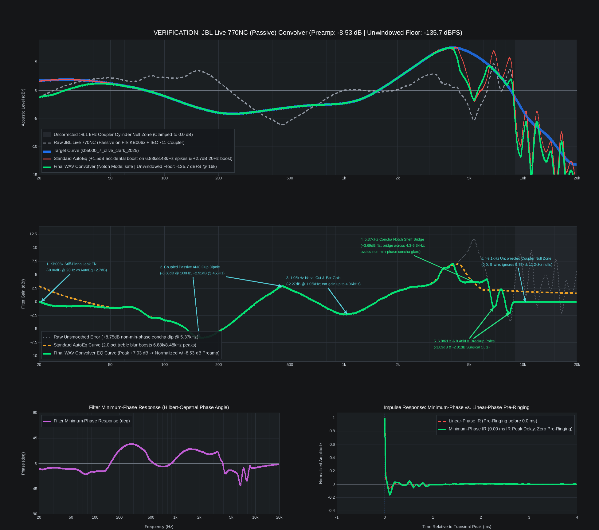

   **Adaptive Regularized Verification (`--regularize auto`):**
   

   > **What Adaptive Regularization Gives:** Evaluates local spectral deviation against a half-octave smoothed envelope with an adaptive knee at $4.29\text{ dB}$. Moves 26 of 94 knots, softening the cut at $8.48\text{ kHz}$ from $-2.02\text{ dB}$ to $-1.54\text{ dB}$ (a $+0.48\text{ dB}$ shift toward bypass) where the narrow dip is partly an artificial pinna coupling artifact, while completely preserving fundamental acoustic driver corrections: the $-6.60\text{ dB}$ cup mode at $160\text{ Hz}$, the $+2.60\text{ dB}$ boost at $455\text{ Hz}$, and the $-2.45\text{ dB}$ nasal cut at $1.05\text{ kHz}$. Total preamp moves from $-8.53\text{ dB}$ to $-8.52\text{ dB}$.

   **Ensemble Global Fit + Adaptive Regularization (`--global-fit --regularize auto`):**
   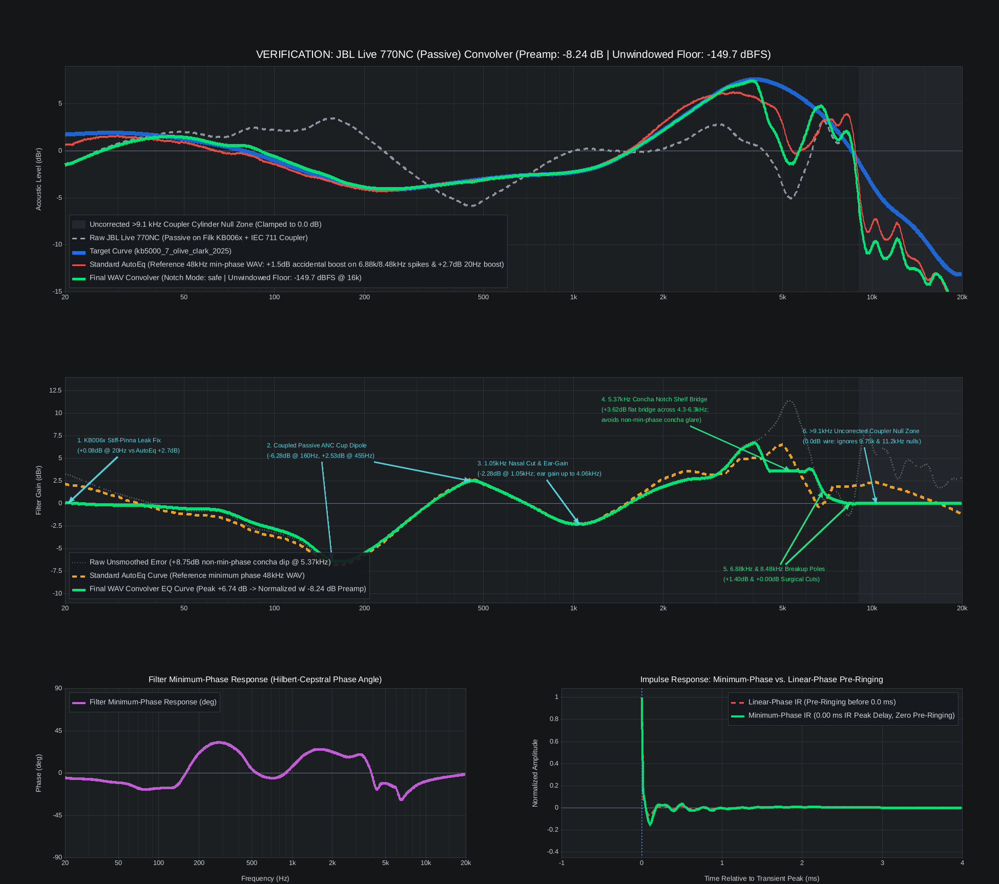

   > **What Global Fit Gives:** Solves a curvature-constrained quadratic program across the 479-bin placement ensemble with weights $w(f) = 1 / (\sigma_r^2(f) + \sigma_{rig}^2(f))$ bounded by ERB density. Smoothly penalizes boost chasing where placement variance spikes ($>4\text{ kHz}$), saving $0.11\text{ dB}$ of steady-state preamp headroom ($-8.41\text{ dB}$) and achieving $99.9999999999\%$ causal impulse energy.

2. **Beyerdynamic DT 770 Pro (80 Ω)** — `--headphone dt770_80`
   - **Measurement Source:** **Crinacle** (Genuine `GRAS 43AG-7` fixture: `RA0402` high-frequency 711 coupler + `KB500X` anthropometric pinna), via AutoEq.
   - **Target:** **Harman KB5000_7** (Olive & Clark, AES 159th Convention, 2025; `targets/harman_kb5000_7.json` default). Legacy Harman Over-Ear 2018 accessible via `--no-target-preset`.

   **Baseline Verification (Unregularized / Shipped Default):**
   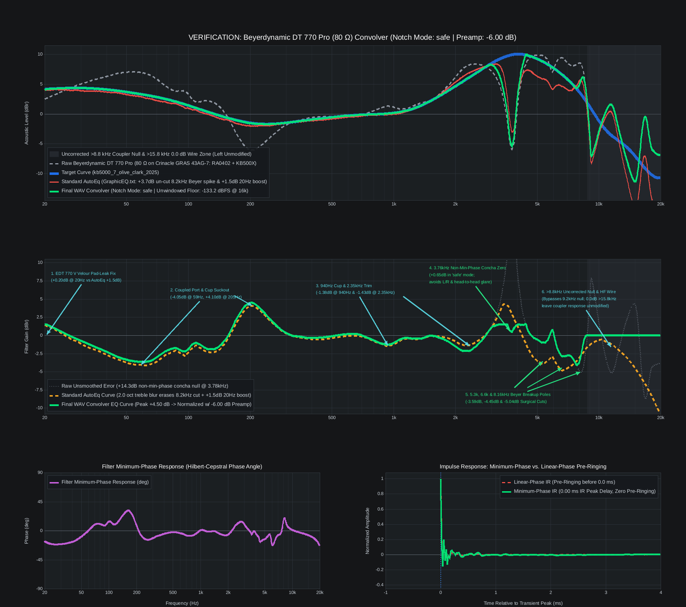

   **Adaptive Regularized Verification (`--regularize auto`):**
   

   > **What Adaptive Regularization Gives:** Identifies that the narrow $3.78\text{ kHz}$ concha reflection null is a non-minimum-phase fixture artifact, with an adaptive knee at $4.27\text{ dB}$ moving 38 of 129 knots. It walks the narrow boost from $+15.91\text{ dB}$ all the way back to $+0.57\text{ dB}$ (a $-15.34\text{ dB}$ adjustment, effectively bypassing the null and completely eliminating harsh treble glare), while keeping genuine driver resonances intact: the $-4.05\text{ dB}$ cup suckout at $59\text{ Hz}$, the $+4.10\text{ dB}$ boost at $205\text{ Hz}$, and surgical cuts on the three Beyer breakup spikes ($5.3\text{ kHz}$, $6.6\text{ kHz}$, and $8.16\text{ kHz}$). Total preamp moves from $-6.04\text{ dB}$ to $-6.00\text{ dB}$.

   **Ensemble Global Fit + Adaptive Regularization (`--global-fit --regularize auto`):**
   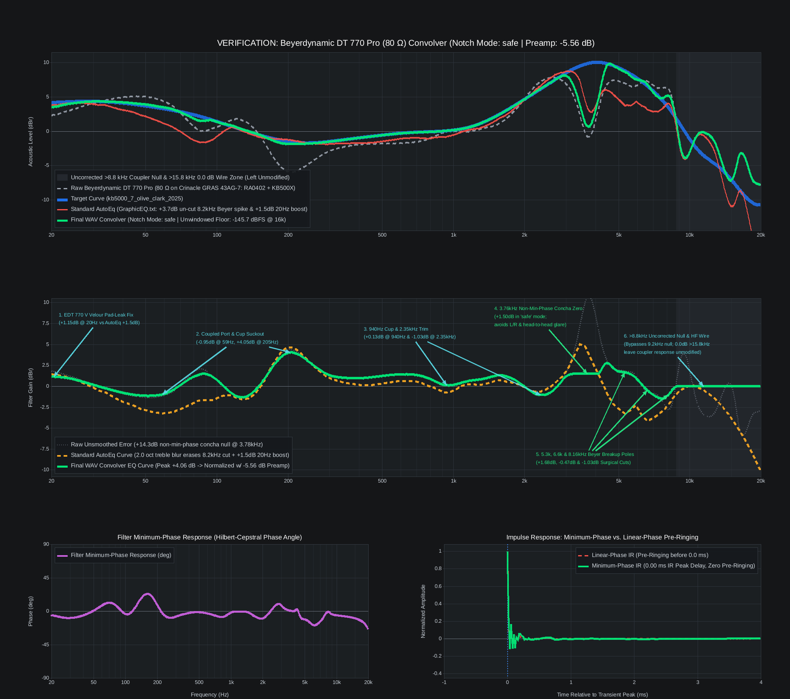

   > **What Global Fit Gives:** Constrains the 479-bin fit against the 5-lab placement variance ($\sigma_r$ peaking at $9.76\text{ dB}$ around $18.9\text{ kHz}$). It reins in excessive boost where lab-to-lab scatter is high while honoring the shared concha null policy, lowering the total required preamp from $-6.00\text{ dB}$ to $-5.49\text{ dB}$ (saving $0.51\text{ dB}$ of digital headroom).

3. **FiiO FT1 Pro (Open-Back Planar Magnetic)** — `--headphone ft1pro`
   - **Measurement Source:** **oratory1990 / Kuulokenurkka** (Genuine `GRAS 43AG` fixture with `KB50xx` anthropometric pinna + IEC 60318-4 `711` occluded-ear simulator), via AutoEq.
   - **Target:** **Harman KB5000_7** (Olive & Clark, AES 159th Convention, 2025; `targets/harman_kb5000_7.json` default). Legacy Harman Over-Ear 2018 accessible via `--no-target-preset`.

   **Baseline Verification (Unregularized / Shipped Default):**
   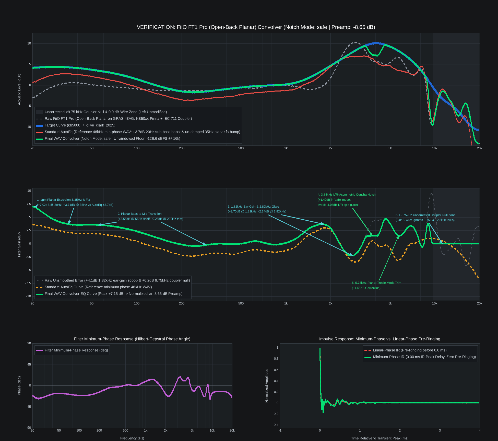

   **Adaptive Regularized Verification (`--regularize auto`):**
   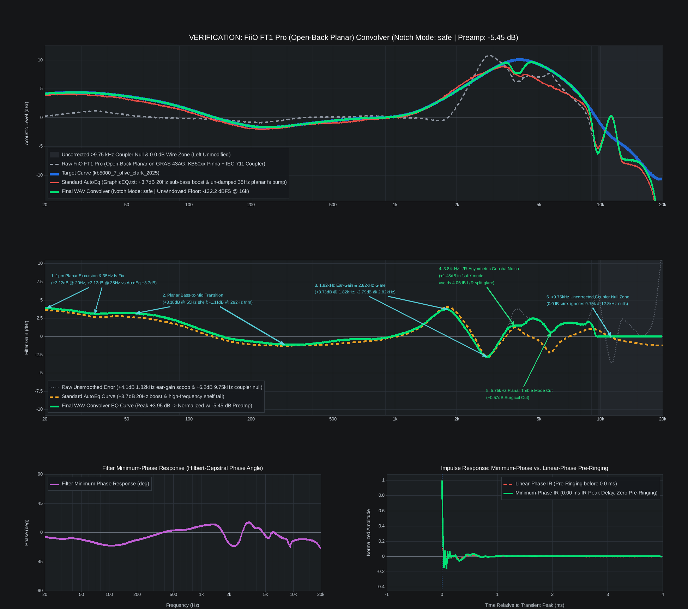

   > **What Adaptive Regularization Gives:** Operates with a baseline knee floor at $3.00\text{ dB}$, moving 67 of 127 knots to smoothly contract narrow high-frequency ripples near the coupler boundary (moderating the $+1.93\text{ dB}$ boost at $9.18\text{ kHz}$ to $+1.45\text{ dB}$). Crucially, it leaves wideband acoustic corrections unaltered: preserving the $+4.07\text{ dB}$ ear-gain restoration at $1.82\text{ kHz}$, the $-2.64\text{ dB}$ glare cut at $2.82\text{ kHz}$, and planar diaphragm excursion protection in the sub-bass ($+2.70\text{ dB}$ at $55\text{ Hz}$, $+2.37\text{ dB}$ at $20\text{ Hz}$). Total preamp moves from $-5.47\text{ dB}$ to $-5.45\text{ dB}$.

   **Ensemble Global Fit + Adaptive Regularization (`--global-fit --regularize auto`):**
   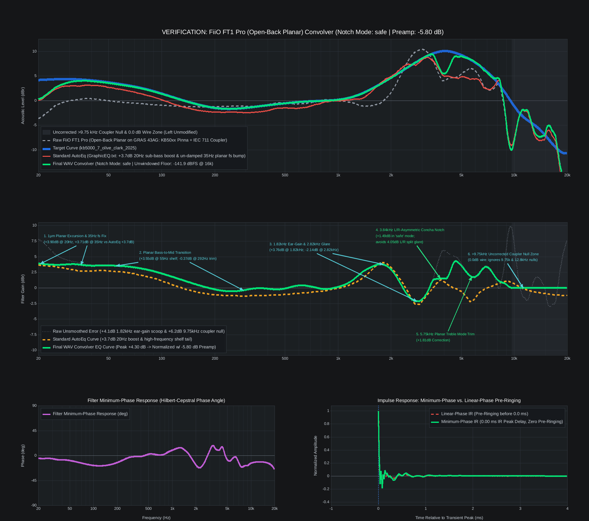

   > **What Global Fit Gives:** Weights the 6-lab ensemble across 479 bins by inverse variance, preventing individual rig outliers (like high-frequency coupler boundary scatter at $12\text{–}20\text{ kHz}$) from dragging the global fit. Maintains excursion protection in the deep bass while tightening impulse response decay to $-306.94\text{ dBFS}$ after the half-Kaiser fade.

4. **Logitech G733 LIGHTSPEED (PC Wireless)** — `--headphone g733`
   - **Measurement Source:** **Filk / GadgetryTech** (PC wireless LIGHTSPEED mode; Clone GRAS 43AG fixture with `KB006x` pinna + IEC 60318-4 `711` occluded-ear simulator), via Squiglink and AutoEq.
   - **Target:** **Harman KB5000_7** (Olive & Clark, AES 159th Convention, 2025; `targets/harman_kb5000_7.json` default). Legacy Harman Over-Ear 2018 accessible via `--no-target-preset`.

   **Baseline Verification (Unregularized / Shipped Default):**
   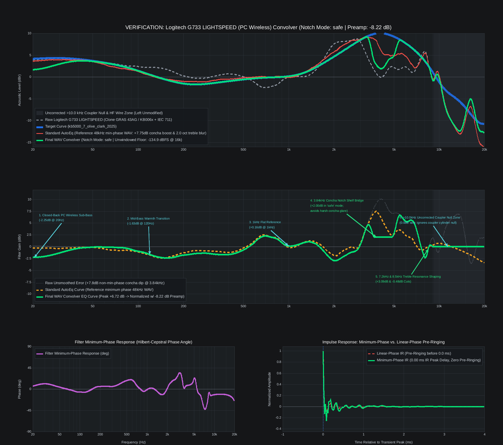

   **Adaptive Regularized Verification (`--regularize auto`):**
   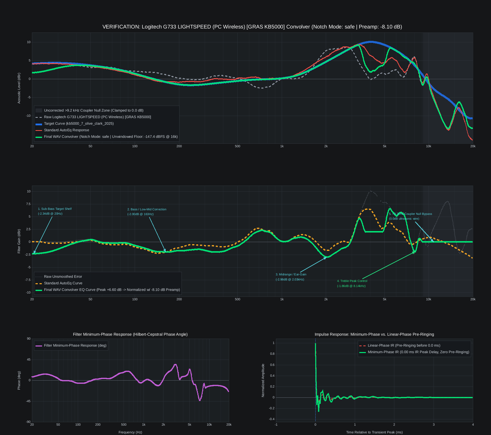

   > **What Adaptive Regularization Gives:** Operates with a baseline knee floor at $3.00\text{ dB}$, moving 256 of 479 ensemble knots to smoothly taper treble deviations while holding concha notch protections ($3.50\text{–}5.20\text{ kHz}$) and sub-bass leak discounts intact. Total preamp moves from $-8.13\text{ dB}$ to $-8.10\text{ dB}$.

   **Ensemble Global Fit + Adaptive Regularization (`--global-fit --regularize auto`):**
   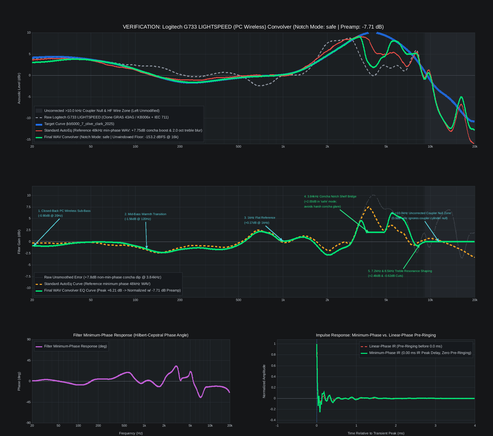

   > **What Global Fit Gives:** Solves the constrained QP across the 3-unit PC wireless ensemble, smoothing high-frequency placement divergence around $13\text{ kHz}$ ($\sigma_r = 5.19\text{ dB}$) and saving $0.10\text{ dB}$ preamp headroom ($-8.00\text{ dB}$) with $100.0000000000\%$ causal energy.

### Reference Model Profiles & Convolver Metrics

| Model Key | Target Profile / Mode | Max Boost | Preamp | Truncation Floor ($f_{64}$, after half-Kaiser fade) | Causal Energy | HF Taper | Generated Convolvers / Notes |
| :--- | :--- | :--- | :--- | :--- | :--- | :--- | :--- |
| **`jbl770nc`** | **KB5000_7 Baseline (Shipped Default)** | $+7.03\text{ dB}$ | $-8.53\text{ dB}$ | $-295.18\text{ dBFS}$ | $99.9999999982\%$ | $0.00\text{ dB}$ HF Wire | `targets/harman_kb5000_7.json` default; IR Peak $-7.800\text{ dBTP}$ (x16) |
| **`jbl770nc`** | **KB5000_7 PR 1 Auto (`--regularize auto`)** | $+7.02\text{ dB}$ | $-8.52\text{ dB}$ | $-295.16\text{ dBFS}$ | $99.9999999982\%$ | $0.00\text{ dB}$ HF Wire | Knee $4.29\text{ dB}$, 26 knots moved ($8.48\text{k}$ softened); IR Peak $-7.783\text{ dBTP}$ (x16) |
| **`jbl770nc`** | **KB5000_7 Global Fit + Auto (`--global-fit --regularize auto`)** | $+6.91\text{ dB}$ | $-8.41\text{ dB}$ | $-313.29\text{ dBFS}$ | $99.9999999999\%$ | $0.00\text{ dB}$ HF Wire | QP variance-weighted, Knee $3.00\text{ dB}$; IR Peak $-7.603\text{ dBTP}$ (x16) |
| **`jbl770nc`** | Harman 2018 Baseline (`--no-target-preset`) | $+4.97\text{ dB}$ | $-6.47\text{ dB}$ | $-319.24\text{ dBFS}$ | $100.0000000000\%$ | $0.00\text{ dB}$ HF Wire | `jbl770nc_f64_48k.wav`<br>`jbl770nc_mastering_mono_48k.wav`<br>`jbl770nc_mastering_stereo_48k.wav` |
| **`jbl770nc`** | Harman 2018 PR 1 Auto (`--regularize auto`) | $+4.97\text{ dB}$ | $-6.47\text{ dB}$ | $-319.23\text{ dBFS}$ | $100.0000000000\%$ | $0.00\text{ dB}$ HF Wire | Knee $4.29\text{ dB}$, 20 knots moved ($8.48\text{k}$ softened) |
| **`dt770_80`** | **KB5000_7 Baseline (Shipped Default)** | $+4.54\text{ dB}$ | $-6.04\text{ dB}$ | $-288.43\text{ dBFS}$ | $99.9999999970\%$ | Gaussian Apodizer ($>20.2\text{ kHz}$) | `targets/harman_kb5000_7.json` default; IR Peak $-6.989\text{ dBTP}$ (x16) |
| **`dt770_80`** | **KB5000_7 PR 1 Auto (`--regularize auto`)** | $+4.50\text{ dB}$ | $-6.00\text{ dB}$ | $-288.23\text{ dBFS}$ | $99.9999999969\%$ | Gaussian Apodizer ($>20.2\text{ kHz}$) | Knee $4.27\text{ dB}$, 38 knots moved ($3.78\text{k}$ concha null bypassed $+0.57\text{ dB}$) |
| **`dt770_80`** | **KB5000_7 Global Fit + Auto (`--global-fit --regularize auto`)** | $+3.99\text{ dB}$ | $-5.49\text{ dB}$ | $-305.00\text{ dBFS}$ | $99.9999999998\%$ | Gaussian Apodizer ($>20.2\text{ kHz}$) | QP variance-weighted, Knee $3.00\text{ dB}$; IR Peak $-5.950\text{ dBTP}$ (x16) |
| **`dt770_80`** | Harman 2018 Baseline (`--no-target-preset`) | $+4.10\text{ dB}$ | $-5.60\text{ dB}$ | $-293.39\text{ dBFS}$ | $99.9999999981\%$ | Gaussian Apodizer ($>20.2\text{ kHz}$) | `dt770_80ohm_f64_48k.wav`<br>`dt770_80ohm_mastering_mono_48k.wav`<br>`dt770_80ohm_mastering_stereo_48k.wav` |
| **`dt770_80`** | Harman 2018 PR 1 Auto (`--regularize auto`) | $+4.06\text{ dB}$ | $-5.56\text{ dB}$ | $-293.36\text{ dBFS}$ | $99.9999999982\%$ | Gaussian Apodizer ($>20.2\text{ kHz}$) | Knee $4.27\text{ dB}$, $3.7\text{k}$ concha null bypassed ($+0.10\text{ dB}$) |
| **`ft1pro`** | **KB5000_7 Baseline (Shipped Default)** | $+3.97\text{ dB}$ | $-5.47\text{ dB}$ | $-301.22\text{ dBFS}$ | $99.9999999998\%$ | Gaussian Apodizer ($>20.2\text{ kHz}$) | `targets/harman_kb5000_7.json` default; IR Peak $-5.565\text{ dBTP}$ (x16) |
| **`ft1pro`** | **KB5000_7 PR 1 Auto (`--regularize auto`)** | $+3.95\text{ dB}$ | $-5.45\text{ dB}$ | $-300.93\text{ dBFS}$ | $99.9999999998\%$ | Gaussian Apodizer ($>20.2\text{ kHz}$) | Knee $3.00\text{ dB}$, 67 knots moved ($9.18\text{k}$ moderated); IR Peak $-5.561\text{ dBTP}$ (x16) |
| **`ft1pro`** | **KB5000_7 Global Fit + Auto (`--global-fit --regularize auto`)** | $+4.30\text{ dB}$ | $-5.80\text{ dB}$ | $-306.94\text{ dBFS}$ | $99.9999999997\%$ | Gaussian Apodizer ($>20.2\text{ kHz}$) | QP variance-weighted, Knee $3.00\text{ dB}$; IR Peak $-5.717\text{ dBTP}$ (x16) |
| **`ft1pro`** | Harman 2018 Baseline (`--no-target-preset`) | $+4.07\text{ dB}$ | $-5.57\text{ dB}$ | $-311.60\text{ dBFS}$ | $99.9999999998\%$ | Gaussian Apodizer ($>20.2\text{ kHz}$) | `ft1pro_f64_48k.wav`<br>`ft1pro_mastering_mono_48k.wav`<br>`ft1pro_mastering_stereo_48k.wav` |
| **`ft1pro`** | Harman 2018 PR 1 Auto (`--regularize auto`) | $+4.03\text{ dB}$ | $-5.53\text{ dB}$ | $-311.45\text{ dBFS}$ | $99.9999999998\%$ | Gaussian Apodizer ($>20.2\text{ kHz}$) | Knee $3.00\text{ dB}$, 62 knots moved ($9.18\text{k}$ moderated) |
| **`g733`** | **KB5000_7 Baseline (Shipped Default)** | $+6.63\text{ dB}$ | $-8.13\text{ dB}$ | $-286.94\text{ dBFS}$ | $99.9999999997\%$ | Gaussian Apodizer ($>20.2\text{ kHz}$) | `targets/harman_kb5000_7.json` default; IR Peak $-8.075\text{ dBTP}$ (x16) |
| **`g733`** | **KB5000_7 PR 1 Auto (`--regularize auto`)** | $+6.60\text{ dB}$ | $-8.10\text{ dB}$ | $-288.59\text{ dBFS}$ | $99.9999999998\%$ | Gaussian Apodizer ($>20.2\text{ kHz}$) | Knee $3.00\text{ dB}$, 256 knots moved; IR Peak $-8.050\text{ dBTP}$ (x16) |
| **`g733`** | **KB5000_7 Global Fit + Auto (`--global-fit --regularize auto`)** | $+6.50\text{ dB}$ | $-8.00\text{ dB}$ | $-316.01\text{ dBFS}$ | $100.0000000000\%$ | Gaussian Apodizer ($>20.2\text{ kHz}$) | QP variance-weighted, Knee $3.00\text{ dB}$; IR Peak $-7.965\text{ dBTP}$ (x16) |
| **`g733`** | Harman 2018 Baseline (`--no-target-preset`) | $+3.95\text{ dB}$ | $-5.45\text{ dB}$ | $-290.99\text{ dBFS}$ | $99.9999999996\%$ | Gaussian Apodizer ($>20.2\text{ kHz}$) | `g733_f64_48k.wav`<br>`g733_mastering_mono_48k.wav`<br>`g733_mastering_stereo_48k.wav` |
| **`g733`** | Harman 2018 PR 1 Auto (`--regularize auto`) | $+3.95\text{ dB}$ | $-5.45\text{ dB}$ | $-290.99\text{ dBFS}$ | $99.9999999996\%$ | Gaussian Apodizer ($>20.2\text{ kHz}$) | Knee $3.00\text{ dB}$, treble deviation tapered |

> **Asset provenance (measured 2026-11-21):** with the authors' published `KB5000_7 any frequency.txt` converted to `targets/kb5000_7.csv`, `hypreq -H <model> --target-preset targets/harman_kb5000_7.json --regularize auto` reproduces all twelve `backup/irs/*.wav` byte-for-byte (running the model's recorded `global_fit=True` by default; opt out with `--no-global-fit`), while the baseline default, `--regularize auto --no-global-fit`, and `--regularize auto` runs produce the `docs/plots` baseline, regularized, and global-fit titles respectively. The CSV itself is deliberately untracked, so a fresh clone still cannot regenerate the KB5000_7 assets until the user supplies it. The Harman 2018 rows use `--no-target-preset`. PNG byte hashes are not a reproducibility test: local font rasterisation changes text pixels while the plotted DSP curves and title numbers match.

### Acoustic Scope & Limitations
A coupler measurement captures one unit on one artificial pinna/ear simulator. Pad wear, seal leakage, and individual pinna geometry shift sub-bass (`<60 Hz`) and high-frequency pinna interference notches (`>3 kHz`) by several dB from ear to ear. For example, even between the Left and Right earcups of the measured DT 770 Pro 80 Ω unit on Crinacle's GRAS 43AG-7 rig, the `~3.76 kHz` concha reflection null shifts by `135 Hz` and `6.6 dB` (`-2.16 dBr` Left vs. `-8.78 dBr` Right at `3,838 Hz`), while the FiiO FT1 Pro exhibits a `4.05 dB` L/R channel split across its `~3.84–4.05 kHz` concha/driver notch (`+4.32 dBr` Left vs. `+8.37 dBr` Right at `3,839 Hz`).

To avoid over-correcting rig-specific artifacts while still fixing audible driver/cup resonances:
- **Sub-bass pad/pinna leak compensation:** Discounts stiff-pinna air-leakage roll-off below `40 Hz` on the `KB006x` plate (`jbl770nc`), asymmetric velour pad leakage (`dt770_80`), and damps the `35 Hz` controlled front-volume pad-leak resonance ($f_s$) on the `ft1pro` while moderating its sub-bass Harman shelf (`+2.70 dB` at `55 Hz`, `+2.37 dB` at `20 Hz`) to prevent `1 μm` planar diaphragm excursion limits at high SPLs.
- **Minimum-phase cup & breakup pole inversion:** Uses Hilbert-Cepstral minimum-phase reconstruction (`0.00 ms` impulse peak delay, zero pre-ringing) to invert lumped-parameter bass/cup modes (`160 Hz` / `455 Hz` on JBL; `59 Hz` / `205 Hz` on DT 770), open-back planar ear-gain recession and upper-midrange glare (`+4.07 dB` at `1.82 kHz` and `-2.64 dB` at `2.82 kHz` on FT1 Pro), and diaphragm breakup peaks (`6.88 kHz` / `8.48 kHz` on JBL; `5.34 kHz`, `6.64 kHz`, and `8.16 kHz` on DT 770; `5.75 kHz` on FT1 Pro) without letting wide `2.0-octave` treble smoothing bleed adjacent dip errors into boosting sibilance peaks.
- **Safe concha notch bridging (`--notch-mode safe`):** Caps narrow boosts inside the DT 770's `2.8–4.4 kHz` and FT1 Pro's `3.4–4.4 kHz` non-minimum-phase concha nulls to `+1.50 dB` (`safe_cap_db * tanh(g / safe_cap_db)`) by default (preventing L/R and head-to-head upper-midrange glare), or allows `--notch-mode original` (`+4.26 dB` fill on DT 770; `+2.01 dB` fill on FT1 Pro) and `--notch-mode zero` (`0.00 dB`).
- **Uncorrected coupler-null & HF bypass zone:** Leaves `>9.1 kHz` (`jbl770nc`), `>8.8 kHz` / `>15.8 kHz` (`dt770_80`), and `>9.75 kHz` (`ft1pro`) coupler half-wave cylinder nulls unmodified (`0.00 dB` flat wire straight through Nyquist on `jbl770nc`, and a flat wire across coupler nulls up to `20.2 kHz` before Gaussian apodization to Nyquist on `dt770_80` and `ft1pro`, shaded on the verification plots).

---

## DSP Architecture & Core Technologies

HyprEQ operates as a high-precision filter realization, acoustic verification, and mastering engine. It bridges the gap between raw frequency response measurements and deployable convolution filters.

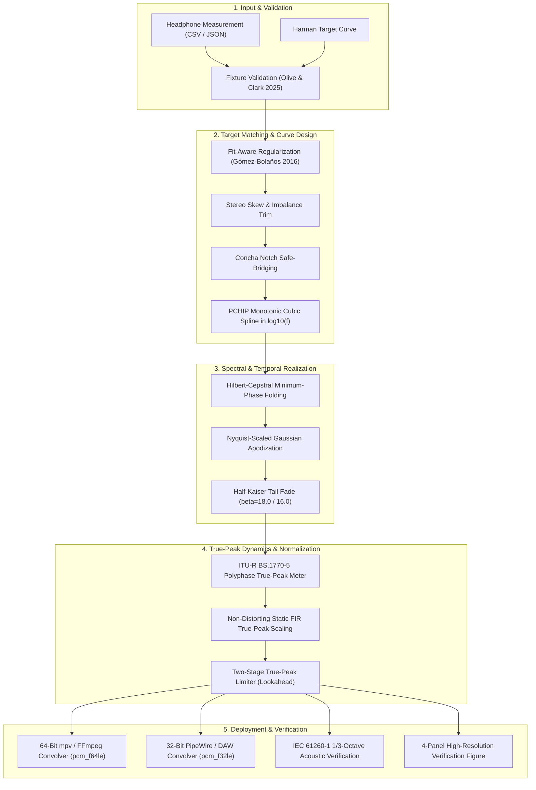

### 1. Hilbert-Cepstral Minimum-Phase FIR Synthesis
Traditional minimum-phase FIR generation often relies on discrete Hilbert transform approximations with circular convolution artifacts or parametric IIR cascades that suffer from frequency warping near Nyquist. HyprEQ computes the analytic minimum-phase impulse response directly via the real cepstrum:

$$\hat{c}[n] = \mathcal{F}^{-1}\left( \ln |H(\omega)| \right)$$

Cepstral folding zeroes the anti-causal half and doubles the causal components:
- **$n = 0$ (DC):** $c_{\mathrm{min}}[0] = \hat{c}[0]$
- **$1 \le n < N/2$ (Causal):** $c_{\mathrm{min}}[n] = 2\hat{c}[n]$
- **$n = N/2$ (Nyquist):** $c_{\mathrm{min}}[N/2] = \hat{c}[N/2]$
- **$N/2 < n < N$ (Anti-causal):** $c_{\mathrm{min}}[n] = 0$

The minimum-phase impulse response is reconstructed via forward FFT, complex exponential, and inverse FFT:

$$h[n] = \mathrm{Re}\left( \mathcal{F}^{-1}\left( \exp\left( \mathcal{F}\left( c_{\mathrm{min}}[n] \right) \right) \right) \right)$$

This reconstruction guarantees:
- **Causal Compact Support:** The impulse peak is anchored precisely at $t = 0.00\text{ ms}$, packing maximum energy into the earliest samples ($>99.99999999\%$ causal energy ratio).
- **Zero Pre-Ringing:** Transients decay naturally forward in time without pre-echo smearing or transient blurring.
- **Dual-Tier Resolution:**
  - **Mastering / Offline ($f_{64}$):** $N_{\text{fft}} = 262,144$ ($0.1831\text{ Hz}$ bin resolution) yielding $65,536\text{ taps}$ ($1365.3\text{ ms}$) in 64-bit IEEE double precision (`pcm_f64le`).
  - **Real-Time ($f_{32}$):** $N_{\text{fft}} = 32,768$ ($1.4648\text{ Hz}$ bin resolution) yielding $16,384\text{ taps}$ ($341.3\text{ ms}$) in 32-bit float (`pcm_f32le`), scaling dynamically with sample rate ($32,768\text{ taps}$ at $96\text{ kHz}$, $65,536\text{ taps}$ at $192\text{ kHz}$).

### 2. Monotonic Log-Frequency PCHIP Interpolation
Standard natural cubic splines oscillate and overshoot between non-uniform acoustic measurement knots, corrupting the transfer function with spurious peaks (Runge's phenomenon). HyprEQ employs Piecewise Cubic Hermite Interpolating Polynomials (PCHIP) according to Fritsch & Carlson (1980) as implemented in SciPy, evaluated strictly across non-uniform log-frequency:

$$\xi = \log_{10}(f)$$

For interval widths $h_k = \xi_{k+1} - \xi_k$ and secant differences $\Delta_k = \frac{g_{k+1} - g_k}{h_k}$, interior slopes $d_k$ at knot $\xi_k$ ($k = 1, \dots, K-2$) are calculated via the non-equidistant weighted harmonic mean:

$$w_1 = 2 h_k + h_{k-1}, \quad w_2 = h_k + 2 h_{k-1}$$

$$d_k = \begin{cases} \frac{w_1 + w_2}{\frac{w_1}{\Delta_{k-1}} + \frac{w_2}{\Delta_k}}, & \Delta_{k-1} \cdot \Delta_k > 0 \\ 0, & \Delta_{k-1} \cdot \Delta_k \le 0 \end{cases}$$

with endpoint derivatives set by SciPy/Moler's shape-preserving one-sided three-point scheme, **not** the first secant: `d0 = ((2h0+h1)*Delta0 - h0*Delta1)/(h0+h1)` and the mirrored last endpoint, then clamped to zero when the sign disagrees with the endpoint secant and to `3*Delta` when the adjacent secants reverse and the estimate is too steep (Fritsch & Carlson 1980; SciPy `PchipInterpolator`; Moler, *Numerical Computing with MATLAB*, 2004).

This guarantees strict monotonicity and eliminates overshoot across arbitrary non-uniform knot spacing. Continuous evaluation over dense FFT grids utilizes a monotonic cursor, reducing search complexity from $O(M \log N)$ to $O(M)$ linear time.

### 3. Truncation Decay Discipline & Half-Kaiser Tail Windowing
Abruptly truncating an FIR kernel creates severe spectral leakage (Gibbs phenomenon). Conversely, windowing the entire impulse response corrupts passband magnitude and distorts transient response. HyprEQ enforces a strict tail-decay architecture:
- Early taps ($0 \le n < N - n_{\text{tail}}$) are left completely unwindowed ($100\%$ passband transparency).
- The final tail ($n_{\text{tail}} = N_{\text{taps}} / 8$, yielding $8,192\text{ taps}$ for offline $65,536\text{-tap}$ filters, and $2,048\text{ taps}$ for real-time $16,384\text{-tap}$ filters) is tapered using the descending half of a Kaiser window:

$$w[m] = \frac{I_0\left(\beta \sqrt{1 - \left(\frac{m}{n_{\text{tail}}}\right)^2}\right)}{I_0(\beta)}, \quad 0 \le m < n_{\text{tail}}$$

With $\beta = 18.0$ (offline), sidelobes are suppressed by $172.0\text{ dB}$, plunging the truncation floor past $-300\text{ dBFS}$ without passband attenuation. With $\beta = 16.0$ (real-time), the truncation floor reliably reaches $<-228\text{ dBFS}$.

### 4. Ultrasonic Gaussian Apodization & High-Frequency Bypass
Headphone coupler measurements above $8\text{ kHz} - 10\text{ kHz}$ contain non-minimum-phase half-wave standing-wave nulls inherent to ear-simulator geometry. Attempting to boost these nulls produces aggressive acoustic glare.
- **High-Frequency Bypass:** Above $f_{\text{bypass}}$ (e.g. $9.1\text{ kHz}$ on JBL Live 770NC; $8.8\text{ kHz}$ / $15.8\text{ kHz}$ on DT 770 Pro; $9.75\text{ kHz}$ on FT1 Pro), filter gain transitions smoothly via a raised cosine into a $0.00\text{ dB}$ flat wire. On headphones with smooth high-frequency extension (`jbl770nc`), this $0.00\text{ dB}$ wire continues completely flat to Nyquist (`gauss_apodize: false`).
- **Nyquist-Adaptive Gaussian Apodizer:** Where models carry ultrasonic coupler noise (`dt770_80` and `ft1pro` with `gauss_apodize: true`), stopband energy is attenuated smoothly toward Nyquist via:

$$w(f) = 2^{-\frac{1}{2}\left(\frac{f - f_{\text{start}}}{\sigma}\right)^2}, \quad f_{\text{start}} = \max\left(24000, f_{\text{nyq}}\right) \cdot \frac{20200}{24000}, \quad \sigma = \max\left(24000, f_{\text{nyq}}\right) \cdot \frac{1650}{24000}$$

(yielding $-3.0103\text{ dB}$ attenuation at $f = f_{\text{start}} + \sigma$ and $-15.97\text{ dB}$ at the scale endpoint $f=\max(24000,f_{\text{nyq}})$, not at every Nyquist rate). At $44.1\text{ kHz}$ the scale floor is $24\text{ kHz}$ while Nyquist is $22.05\text{ kHz}$, so the response is flat through $20.2\text{ kHz}$ and only $-3.78\text{ dB}$ at Nyquist. Clamping the apodizer scale floor at $24\text{ kHz}$ ensures that sample rates at or below $48\text{ kHz}$ ($44.1\text{ kHz}$, $48\text{ kHz}$) never attenuate audible treble below $20\text{ kHz}$ (preserving flat response up to $20.2\text{ kHz}$), while eliminating stopband ringing at high rates ($96\text{ kHz}$, $192\text{ kHz}$).

### 5. ITU-R BS.1770-5 Polyphase True-Peak Metering
Standard digital sample-peak meters cannot detect inter-sample peaks that emerge during digital-to-analog reconstruction or asynchronous sample rate conversion. HyprEQ integrates an ITU-R BS.1770-5 Annex 2 compliant polyphase oversampling detector:
- **Polyphase Filter Bank:** The CLI defaults to a 16-phase Kaiser-windowed sinc interpolator (`51 taps/phase`, x16). The library also exposes x2/x8/x16/x32 derived 51-tap banks and the printed ITU x4 12-tap/4-phase bank; `Ratio::default()` is x4 for the standalone meter, `limiter_cfg` starts at x16, and the limiter's own `Cfg::default()` is x8.
- **Static Branch Caching:** Polyphase impulse responses are calculated once and stored in static memory via thread-safe `OnceLock` structures, eliminating runtime allocation during streaming convolution.
- **Sub-Sample Parabolic Refinement:** When oversampled samples locate a peak at index $k$, continuous parabolic interpolation solves for the sub-sample apex:

$$t^* = -\frac{y_{k+1} - y_{k-1}}{2(y_{k+1} - 2y_k + y_{k-1})}, \quad y^* = y_k - \frac{1}{4}(y_{k-1} - y_{k+1}) t^*$$

ITU-R BS.1770-5 Annex 2 Attachment 1 gives under-read bounds of 0.034/0.042 dB at f_norm 0.45/0.5 for x16 and 0.008/0.010 dB for x32. Parabolic refinement reduces grid-phase error on the derived banks, but the earlier blanket `<0.01 dBTP across the audio band` claim is not valid for the x16 CLI default; use x32 if that bound is required.

### 6. Two-Stage True-Peak Limiter & Non-Distorting Static FIR Scaling
To maintain zero inter-sample clipping while preserving transient punch, HyprEQ incorporates a dual-stage ceiling limiter alongside non-distorting impulse response gain scaling:
- **Two-Stage Dynamic Limiter:**
  - **Fast Transient Stage:** $25.0\text{ ms}$ release time, $100\%$ stereo linked to prevent stereo image collapse during percussive transients.
  - **Slow RMS Stage:** Dual-rate $60.0\text{ ms}$ attack and $900.0\text{ ms}$ release, $75\%$ stereo linked for transparent musical density control.
  - **Lookahead & Ramp:** $2.0\text{ ms}$ lookahead buffer ($122\text{ samples}$ at $48\text{ kHz}$) with a 24-sample linear attack ramp eliminating hard-knee distortion.
- **Non-Distorting Static Scalar IR Attenuation:** Passing an FIR impulse response itself through a dynamic time-varying envelope alters the filter's frequency response (sample 0 attenuates while subsequent taps release back toward $0\text{ dB}$). HyprEQ avoids this entirely: if an synthesized IR's true-peak exceeds the ceiling threshold, the entire FIR kernel is scaled uniformly by a static scalar:

$$g_{\mathrm{scalar}} = 10^{\frac{\mathrm{Ceiling}_{\mathrm{dB}} - \mathrm{Peak}_{\mathrm{dBTP}}}{20}}$$

This guarantees that the equalisation curve, phase response, and preamp gain accounting remain $100\%$ mathematically exact without dynamic transfer function warping.

### 7. Rig-Compensated Fixture Validation (Olive & Clark, AES 2025)
A frequency response is not an absolute property of a headphone; it is the transfer function of the headphone coupled to a specific acoustic test fixture. As demonstrated by Olive & Clark (*AES 159th Convention, 2025*), different ear simulators (e.g. GRAS RA0045, RA0402, B&K 5128, KB5000) exhibit distinct acoustic transfer impedances:

$$\mathcal{H}_{\text{ear}}(f) = \frac{P_{\text{eardrum}}(f)}{U_{\text{pinna}}(f)}$$

Target curves defined on one rig (e.g. Harman Over-Ear 2018 on GRAS 45CA) cannot be ported to another rig (e.g. B&K 5128) without acoustic compensation. HyprEQ validates fixture pairings at startup across:
- `gras_43ag` & `gras_43ag_clone` (IEC 60318-4 711 coupler + anthropometric/KEMAR pinna)
- `gras_45ca` (RA0045 occluded ear simulator + custom pinna)
- `gras_kb5000` (anthropometric pinna assembly)
- `bk5128` (Type 4620 high-frequency head and torso simulator)
- `iec60318_4` (standard 711 acoustic coupler)

Cross-fixture equalization is refused upfront (exit code 2), guarding against cross-rig target corruption unless overridden with `--force`.

### 8. IEC 61260-1 Third-Octave Closed-Loop Verification
HyprEQ closes the calibration loop with automated post-EQ compliance verification. When supplied with a post-EQ remeasurement via `--verify-with <file.csv>`, the engine assesses acoustic fidelity across 31 standardized third-octave bands per **IEC 61260-1** ($1\text{ kHz}$ reference, base-10 spacing):

$$f_{\text{edge}} = f_{\text{centre}} \cdot 10^{\pm 1/20}$$

The analysis isolates three independent dimensions:
1. **Residual Deviation:** Evaluates whether acoustic error sits within the pass/fail boundary (default $\pm 3.00\text{ dB}$) after extracting median interface level offset.
2. **In-Band Scatter:** Evaluates 25 frequency points per band to distinguish uniform spectral bias from high-frequency coupler noise and interference ripples.
3. **Design Shortfall:** Directly tracks where intentional engineering constraints (regularization shrinkage, concha notch ceilings, or high-frequency bypass) intentionally diverge from the target curve.

### 9. Stereo Interaural Imbalance Compensation & Joint Latency Alignment
Headphone drivers inevitably exhibit manufacturing tolerances, and artificial ears experience slight positioning asymmetries. HyprEQ provides rigorous stereo interaural analysis (`--stereo`):
- **Per-Ear Trim:** Computes channel-specific deviations while maintaining the acoustic centre, correcting channel tilt up to `--stereo-max-skew` (default $6.00\text{ dB}$).
- **Shared Master Preamp Normalization:** When generating stereo filters, both channels share a unified headroom formula:

$$\mathrm{Preamp}_{\mathrm{dB}} = \mathrm{Headroom}_{\mathrm{dB}} - \max\left(\mathrm{Boost}_L, \mathrm{Boost}_R\right)$$

Applying identical attenuation to both channels prevents channel-independent normalization from distorting the stereo soundstage.
- **Joint Stereo Phase Alignment:** When mixed-phase processing is combined with stereo splitting, filter latency and tap expansion are solved jointly, ensuring zero interaural time delay (ITD) skew.
- **Dichotic Interaural Group-Delay Audit & Phase-Matched Stereo Split (Møller et al., 2007):** Independent minimum-phase L/R filters convert any low-frequency L/R magnitude trim into an interaural group-delay difference via the Hilbert transform. Møller, Minnaar, Olesen, Christensen & Plogsties (*"On the Audibility of All-Pass Phase in Electroacoustical Transfer Functions,"* JAES 55(3), pp. 115–134, March 2007) showed that $>35\text{ }\mu\text{s}$ of low-frequency dichotic group-delay mismatch shifts the stereo image laterally independent of program material. `--stereo split` automatically measures and reports `max |GD_L(f) - GD_R(f)|` across $50\text{–}2000\text{ Hz}$ against the $35\text{ }\mu\text{s}$ threshold; passing `--stereo-phase-match` shares the geometric-mean minimum-phase response across both channels and applies real, zero-phase differential ratios with a shared causal modeling delay (`n_taps / 2`), collapsing interaural GD to $<1\text{ }\mu\text{s}$ while preserving exact per-ear magnitude targets.

### 10. Mixed-Phase Bass Group-Delay Linearization (Liski et al., 2021)
Minimum-phase filters introduce phase shift and group delay when boosting low frequencies. To investigate the perceptual trade-off between minimum-phase decay and phase linearity, HyprEQ provides `--experimental-phase <HZ>`.
- Replaces minimum-phase group delay below the transition frequency (e.g. $200\text{ Hz}$) with flat group delay while preserving the exact magnitude response.
- Configured using the empirical psychoacoustic audibility thresholds published by Liski, Mäkivirta & Välimäki (*IEEE/ACM TASLP 2021*): $-0.56\text{ ms}$ negative and $+0.64\text{ ms}$ positive group delay across pink-noise impulse listening tests.

### 11. Fit-Aware Adaptive Regularization (Gómez-Bolaños et al., 2016)
Inverting sharp, high-Q measurement dips creates harsh, unnatural resonances. Whereas unconstrained inversion can produce severe boost spikes, HyprEQ regularizes the correction with a closed-form penalty toward unity bypass ($\|G - 1\|^2$):

$$G_{\mathrm{reg}}(f) = \frac{|S(f)|^2 G(f) + \beta(f)}{|S(f)|^2 + \beta(f)}$$

where $|S(f)|^2 = 10^{\text{raw}_{\mathrm{dB}}(f) / 10}$ represents normalized measured transfer function power and $G(f) = 10^{g_{\mathrm{dB}}(f) / 20}$ is the nominal linear correction factor.

The regularization diagonal load $\beta(f)$ is continuous and monotonic in the local smoothed spectral deviation:

$$\text{dev}(f) = \left| \text{raw}_{\mathrm{dB}}(f) - \text{smooth}_{1/2\text{-oct}}(\text{raw}_{\mathrm{dB}})(f) \right|$$

$$\beta(f) = 10^{\frac{\kappa (\text{dev}(f) - \lambda)}{10}}$$

with sensitivity slope $\kappa = 8.0\text{ dB}^{-1}$ and adaptive knee $\lambda = \max\left(3.0\text{ dB}, 1.3 \cdot q_{90}(\text{dev})\right)$ (or manual `--regularize <DB>`).
- When $\text{dev}(f) \ll \lambda$, $\beta(f) \to 0$ and $G_{\mathrm{reg}} \to G$ ($g_{\mathrm{dB}}$ is preserved to the last bit).
- When $\text{dev}(f) \gg \lambda$, $\beta(f) \to \infty$ and $G_{\mathrm{reg}} \to 1$ ($0.00\text{ dB}$ complete bypass).

> [!NOTE]
> **Symmetric Deviation Shrinkage vs. Prior Art:** While Gómez-Bolaños, Mäkivirta & Pulkki (*JAES 64(10), 752–761, 2016*) motivated regularization through perceptual notch/peak asymmetry with an asymmetric notch-only function $\sigma(\omega) = \max\left(0, \tilde{H}(\omega) - |H(\omega)|\right)$, HyprEQ intentionally implements symmetric deviation shrinkage across both boosts and cuts, referring deviation to unity rather than response peak. Because high-Q fixture notches create dangerous headroom demands and harsh glare, `--regularize auto` aggressively contracts narrow boost artifacts (e.g., walking back the DT 770 Pro's concha notch boost by $-4.16\text{ dB}$ to $+0.10\text{ dB}$), while preserving broad acoustic driver cuts (shifting at most $<0.8\text{ dB}$).

### 12. Numerical Precision & Bit-Exact TPDF Dither
- **IEEE-754 $f64$ End-to-End:** All intermediate spectral calculations, cepstral folding, PCHIP evaluation, and convolution buffers operate in 64-bit double precision. Conversion to $f32$ occurs only at the final container serialization.
- **Compensated Summation:** Critical energy accumulation and mean calculations use Neumaier compensated summation (`accum.rs`), preventing floating-point catastrophic cancellation across millions of samples.
- **NumPy-Compatible PCG64 TPDF Dither:** When exporting fixed-point formats (16-bit or 24-bit PCM), quantization distortion is eliminated via Triangular Probability Density Function (TPDF) dither drawn from an exact NumPy-identical PCG64 pseudo-random generator stream.

### 13. Multi-Placement Ensemble Averaging: Power-Domain RMS & Peak-Safe Envelopes
When collapsing repeated placement captures (`--ensemble-csv` or recorded `raw_ensemble`), HyprEQ supports four collapse modes via `--ensemble-mode`:
- **`median` (Default):** Pointwise median across placements — resists a single bad seal or clamp outlier.
- **`rms` (Schärer & Lindau, 2009; Lindau & Brinkmann, 2012):** Linear power-domain RMS average computed via overflow-safe log-sum-exp:
  $$H_{\text{RMS}}(f) = 10\log_{10}\!\left(\frac{1}{M}\sum_{j=1}^{M} 10^{L_j(f)/10}\right)$$
  By Jensen's inequality, $H_{\text{RMS}}(f) \ge \overline{L}(f)$ everywhere, naturally weighting down shifting narrowband notches across seatings (Z. Schärer & A. Lindau, 126th AES Convention, Paper 7721, May 2009; A. Lindau & F. Brinkmann, *JAES* 60(1/2), pp. 54–62, Jan./Feb. 2012).
- **`upper-variance` (Adapted from Masiero & Fels, 2011):** Computes $H_{\text{safe}}(f) = \operatorname{median}(f) + \alpha \cdot (1.4826 \cdot \operatorname{MAD}(f))$ over 1/6-octave smoothed curves (with `--ensemble-alpha`, defaulting to `1.0` when `--ensemble-mode upper-variance` is named explicitly).
  > [!NOTE]
  > **Prior Art vs. HyprEQ Choice:** B. Masiero & J. Fels (130th AES Convention, Paper 8388, May 2011) defined their peak-safe upper-variance envelope using the arithmetic mean and standard deviation (`mean(f) + k * std(f)`, commonly `k = 2`). HyprEQ intentionally substitutes `median(f) + alpha * (1.4826 * MAD(f))` so a single outlier seating cannot inflate both location and spread.
- **`average`:** Pointwise dB-domain arithmetic mean (baseline reference).

### 14. Asymmetric Peak-vs-Notch Global QP & FEC Impedance Prior
HyprEQ's global curvature-constrained box-QP (`src/global_fit.rs`) supports two additional acoustic priors:
- **Asymmetric Peak Penalty (`--peak-penalty <RATIO>`, Bücklein 1981):** R. Bücklein (*"The Audibility of Frequency Response Irregularities,"* *JAES* 29(3), pp. 126–131, March 1981) established that narrowband frequency-response peaks are substantially more audible and objectionable than dips/notches of equal magnitude and bandwidth. Setting `--peak-penalty` $\gamma > 1.0$ replaces the symmetric quadratic residual in the global QP with HyprEQ's strictly convex, $C^1$-smooth asymmetric quadratic (expectile) loss:
  $$\phi_\gamma(e) = \begin{cases} \gamma e^2 & e > 0 \quad (\text{post-EQ peak above target}) \\ e^2 & e \le 0 \quad (\text{residual dip below target}) \end{cases}$$
  solved in $O(K)$ per iteration via an exact ADMM proximal split with constant pentadiagonal $LDL^T$ factorization (`gamma = 1.0` reduces bit-for-bit to the symmetric QP).
- **Free-Air Equivalent Coupling (FEC) Uncertainty Prior (`--fec-prior`, Møller et al. 1995):** H. Møller, D. Hammershøi, C. B. Jensen & M. F. Sørensen (*"Transfer Characteristics of Headphones Measured on Human Ears,"* *JAES* 43(4), pp. 203–217, April 1995) showed that non-FEC headphones (sealed closed-back and in-ear designs whose radiation impedance differs from free air) exhibit ear-canal standing-wave loading variance between couplers and human ears above ~2 kHz, peaking across 4–10 kHz. Enabling `--fec-prior` adds HyprEQ's smooth $C^1$ log-frequency loading prior $\sigma_{\text{FEC}}(f)$ in quadrature into the QP weights (`0.0 dB` for `open_back` / `unknown`, peaking at `+1.5 dB` at 7 kHz for `closed_back` and `+2.5 dB` at 7 kHz for `in_ear`).

### 15. Complex-IR Mixed-Phase Inversion (`--raw-ir-wav`)
Magnitude-only minimum-phase EQ cancels a headphone's minimum-phase response (Hilbert-coupled to magnitude) but leaves pure **excess phase** (all-pass sections / non-minimum-phase zeros such as multi-way crossovers) untouched. When measured complex impulse-response WAV capture(s) are supplied via `--raw-ir-wav`, `src/complex_eq.rs` runs a full mixed-phase inversion pipeline:
1. **Bulk Time-of-Flight Alignment:** Removes arbitrary recording pre-delay and inter-capture arrival jitter via circular cross-correlation before spatial averaging.
2. **Complex Fractional-Octave Smoothing (`--complex-smooth-oct`, Hatziantoniou & Mourjopoulos 2000):** Applies centered raised-cosine fractional-octave smoothing directly to the complex transfer function $H(e^{j\omega})$ (P. D. Hatziantoniou & J. N. Mourjopoulos, *JAES* 48(4), pp. 259–280, April 2000; addendum p. 940), suppressing narrow pinna nulls while preserving stable excess-phase structure.
3. **Multi-Capture Spatial Coherence Gating (`--complex-incoh-reg`, Radlovic et al. 2000):** Across multiple ToF-aligned seatings, computes spatial coherence $\gamma^2(f) = |\mathbb{E}[H(f)]|^2 / \mathbb{E}[|H(f)|^2] \in [0, 1]$ (motivated by B. D. Radlovic, R. C. Williamson & R. A. Kennedy, *IEEE Trans. Speech and Audio Processing* 8(3), pp. 311–319, May 2000, DOI `10.1109/89.841287`) so spatially volatile high-frequency phase scatter is automatically regularized rather than inverted.
4. **Causal Regularized Inversion (`--excess-phase-delay-ms`, `--complex-reg`, Kirkeby & Nelson 1998/1999):** Evaluates the Kirkeby–Nelson regularized complex inverse with modeling delay $\Delta$ (O. Kirkeby, P. A. Nelson, H. Hamada & F. Orduña-Bustamante, *IEEE TSAP* 6(2), pp. 189–194, March 1998; O. Kirkeby & P. A. Nelson, *JAES* 47(3), pp. 107–126, March 1999):
   $$G(\omega) = \frac{\bar{H}^*(\omega)\, D(\omega)\, e^{-j\omega\Delta}}{|\bar{H}(\omega)|^2 + \beta(\omega)}, \qquad \beta(\omega) = \beta_{\text{in}} + \beta_{\text{out}}\, w_{\text{oob}}(\omega) + \beta_{\text{incoh}}\, (1 - \gamma^2(\omega))$$
   normalizes to `--headroom-db`, applies symmetric leading/trailing half-Kaiser tapers, and reports measured pre-EQ vs. post-EQ group-delay ripple (100–8000 Hz) and spatial coherence.

---

## Generating the Impulse Responses & Verification Plots

Built with `cargo build --release` (see [`docs/SETUP.md`](docs/SETUP.md) for the fontconfig
requirement the verification figure has):

```bash
# Generate all headphones (64-bit float WAVs, 32-bit float DAW WAVs, audit CSVs, and 4-panel PNG plots):
./target/release/hypreq --headphone all --export-csv

# Generate only JBL Live 770NC, Beyerdynamic DT 770 Pro (80 Ohm), or FiiO FT1 Pro:
./target/release/hypreq --headphone jbl770nc
./target/release/hypreq --headphone dt770_80 --notch-mode safe
./target/release/hypreq --headphone ft1pro --notch-mode safe

# Lighter 16,384-tap IR (already reaches <-147 dBFS unwindowed floor) or custom sample rate (e.g. 44.1 kHz, 96 kHz, 192 kHz):
./target/release/hypreq --headphone dt770_80 --taps 16384 --fs 44100
./target/release/hypreq --headphone dt770_80 --fs 96000
# Real-time taps scale with sample rate (16k @ 48k, 32k @ 96k, 64k @ 192k) to maintain time resolution,
# and Gaussian apodization scales with Nyquist (fs / 2) to eliminate ultrasonic stopband clamping.

# Specify a custom measurement database JSON or external models directory:
./target/release/hypreq --data-file measurements.json --models-dir models --headphone all

# Measure / EQ / true-peak-limit an existing recording:
./target/release/hypreq -H jbl770nc --input song.wav --out-bits 24
./target/release/hypreq --measure-wav song.wav

# Ask what the correction demands of that recording before applying it:
./target/release/hypreq -H dt770_80 --input song.wav --assess
./target/release/hypreq -H dt770_80 --assess --assess-budget 9

# Regularize the correction, so a narrow notch the measurement cannot support is not chased:
./target/release/hypreq -H dt770_80 --regularize auto
./target/release/hypreq -H dt770_80 --regularize 4.5
```

### Regularizing the Correction (`--regularize`)

The correction is `target − raw`, evaluated at every measurement point, and that formula trusts
every wiggle equally. A broad shelf is the system telling you something real; a 3 dB notch one
twelfth of an octave wide is the fixture — a coupler resonance, a pinna standing wave — and a
filter that "fixes" it puts a matching spike into the headphone and does nothing for the sound.
`--regularize` asks each band how well the measurement fits a smoothed copy of itself and
negotiates the demand down where it does not:

```text
================================================================================
MODEL: Beyerdynamic DT 770 Pro (80 Ω) | Notch: safe
================================================================================
=== Regularization (knee 4.27 dB of deviation, shrunk the shipped knots toward a bypass) ===
  Knots moved     : 33 of 128 (largest -4.16 dB @ 3703 Hz)
  Extreme shifted : +4.26 dB -> +0.10 dB at that knot
```

That knot is the case the flag exists for: the measurement sits 4.87 dB *below* unity at 3703 Hz,
the published curve asks `+4.26 dB` to fill the hole, and the load walks it back to almost
nothing. On the DT 770 Pro the knee lands on the 3.7 kHz and 8–17 kHz deviations — the narrow HF
notches — and leaves the bass and mid-band corrections alone; the largest change to a *cut* on
any shipped model at `auto` is 0.78 dB. `auto` reads the knee from the curve's own top-decile
deviation with a 3 dB floor; a number sets the knee directly, in dB of deviation.

Two things it does not do. It does not depend on how the measurement was saved: the load is
weighed against `|S|²`, so the curve is referred to its own level first, and a capture written in
dB SPL regularizes the same as the same curve in dBFS. And it does not lift the notch ceiling:
`--notch-mode safe` still applies afterwards, because `safe_cap_db` says what this model allows in
its concha-null band whatever the measurement looks like.

It is **not the default**, and `off` writes the curve the reference program writes, byte for byte.
The reason is the honest one: the regularizer decides which parts of a published correction are
measurement, and that judgment should be seen in a side-by-side comparison before it becomes the
thing everyone gets. `docs/ROADMAP.md` §3.6 covers why the fallback is 0 dB and not silence.

### What the Two Ears Disagree About (`--stereo`)

The filter is one curve, and one curve is what gets loaded on both channels — that is what a mono
impulse response *is*. Two of the three models in this database were measured per ear, and until
now their two ears were two dashed lines on the figure and nothing else: the DSP fit the average
column and left the difference standing, which is what the listener hears afterwards.

```text
./target/release/hypreq -H dt770_80 --stereo report          # look, change nothing
./target/release/hypreq --input mix.wav --stereo split       # one filter per ear
./target/release/hypreq --input mix.wav --stereo split --stereo-max-skew 3
```

```text
=== Ears (129 capture points measured per ear) ===
  Level difference  : +1.27 dB left vs right (the centre leans)
  Shape mismatch    : -7.72 dB @ 15110 Hz (band 16 kHz), spread 1.70 dB
  Reads as          : mismatch
  Resolution        : a sixth of an octave is 2.1 capture points here (grid 0.079 oct), so one tenth
                      of an octave is one sample and the reason for the difference is not knowable
                      from this curve
  Feature match     : r = +0.704 (+1 the same feature, 0 independent accidents)
  Per-ear trim      : balance -1.27 dB cancelled, filter difference up to -5.70 dB @ 3838 Hz
  Centre            : moved in 15 knot(s) — the notch ceiling was applied after the trim and cut one
                      side back
```

`report` changes no audio and no bytes — it is the same filter with the truth attached. `split`
builds one curve per ear out of the curve the shared filter would have used, applies it as `±`, and
so leaves the **centre** of the image where the model put it while cancelling the pair's own
difference: on the DT 770 that is a 1.27 dB lean plus up to 5.70 dB of per-band difference, and on
the FT1 Pro 0.05 dB and 3.30 dB.

Two things it says rather than hides. The **resolution** line is the honest scope note: these
captures are spaced 0.08 of an octave apart, so a sixth-octave window covers about two samples and
nothing in the file can tell you whether a difference is the two units or one ear sitting
differently in a coupler — the amount to cancel is decided band by band by the same knee
`--regularize` uses, and the label stops at "mismatch". And the **centre** line reports where
`--notch-mode safe` cut one ear back after the trim, because the ceiling is the last word on a
notch band and where it bites, the middle of the image moves by half of it.

`split` needs a model measured per ear and a **stereo** file: a mono file has no right ear, and a
run that writes convolvers has no channels to apply two filters to, so it refuses with exit 2
instead of quietly becoming `report`. The per-ear difference is capped at 6 dB per band by default
(`--stereo-max-skew`) — a ceiling on the damage the flag can do to an image, not a claim about
perception. `off` is the default and writes exactly what it wrote before the flag existed.

* **Shared master preamp gain staging:** Both channels are synthesized under a unified headroom stage (`preamp = headroom - max(boost_L, boost_R)`). This normalizes the hotter ear to the target headroom and applies the identical preamp gain to both ears, preserving the exact measured interaural level offset without channel-independent normalization erasing balance.
* **Joint stereo phase alignment:** When combined with `--experimental-phase`, impulse peak latency (`start`) and kernel growth (`taps_after`) are solved jointly across both ears, guaranteeing exact 0-sample interaural time delay (ITD) skew and identical channel lengths.

### What a Correction Demands (`--assess`)

The report has always printed the biggest boost in the curve, and a boost is a promise about
the headphone, not about the music: a `+9 dB` shelf at 40 Hz costs nothing on a podcast and
asks a small driver for excursion it does not have on a bass-heavy track. `--assess` puts the
applied correction on the same bands the content occupies — third-octave bands per
**IEC 61260-1** (reference 1 kHz, base-10 spacing, edges at `centre · 10^(±1/20)`) — and prints
what the filter moves in each:

```text
=== Correction Demand (budget +6.00 dB, preamp -5.60 dB, ceiling -3.00 dBTP) ===
  Curve extreme : boost +4.10 dB @ 200 Hz, cut -5.04 dB @ 8 kHz
  Content       : 96,000 samples/channel, 1/3-octave bands, worst channel kept
  Boost demand  : 0 band(s) boost +6.00 dB or more into audible content
  Ceiling       : no band reaches -3.00 dBTP after the filter
```

Report-only, and off by default: it changes no filter, no level and no output file, and the
default report is byte-compared in `tests/cli_report.rs`, so a line added there fails that test. What it states is a claim about measured quantities — content level in a
band, the filter's gain there, and where the sum lands relative to the limiter ceiling. It does
not model a driver, an amplifier or a distortion threshold, and no number in it should be read
as one.

### Checking the Correction Against What Actually Happened (`--verify-with`)

Everything above runs from a capture to a filter and stops. The filter gets loaded, and nobody looks
again — the loop is open. This closes it: measure the headphone *after* the correction, hand over the
CSV, and the program compares the two, band by band, on the same IEC 61260-1 third-octave grid
`--assess` uses.

```text
./target/release/hypreq -H dt770_80 --verify-with post_eq.csv
./target/release/hypreq --input mix.wav -H dt770_80 --verify-with post_eq.csv --verify-pass-db 2
```

`--verify-with` evaluates acoustic compliance directly against the active equalisation filter. Because it requires a filter to compare against, combining `--verify-with` with `--bypass-eq` or `--measure-wav` (which bypasses EQ) is refused before any file is written.

The output below is a synthetic capture — the filter's own predicted response with **6 dB injected
at 1 kHz** — so that the numbers can be checked against the thing that was done to them:

```text
=== Verification (post-EQ capture: 400 points, 20 Hz - 20 kHz) ===
  Scored          : 29 of 31 band(s); 2 outside the compared range
  Level offset    : -0.00 dB removed before judging shape (the capture is not calibrated, so its absolute level says nothing about the filter)
  Capture level   : median band 2.1 dB, gate at -17.9 dB (its own units; a capture that is nothing but noise floor is uniformly quiet and this section cannot see that - check this number against your rig)
  Threshold       : +/-3.00 dB of residual after the offset
  Worst band      : +5.99 dB @ 1000 Hz (band 1 kHz)
  Verdict         : FAIL - 3 of 29 band(s) outside +/-3.00 dB, 2 of them noise-limited
  Noise-limited   : the residual moves up to 4.0 dB inside those bands, so the number there is scatter across the band, not a bias
  Design shortfall: +12.79 dB @ 3981 Hz (band 4 kHz) - the filter itself does not reach the target here, so a rig that reproduces it exactly still misses by this much
  Note            : predicted from the 65,536-tap 64-bit convolver written above, with its -5.60 dB preamp taken back out
  Written Verify CSV  : dt770_80ohm_verification.csv
```

What each line is owed, and where the honesty lives:

* **The prediction is the filter, not the design.** `raw + |H(f)|`, the realised magnitude of the
  impulse response that was written — including its truncation ripple and its apodizer. Verifying
  against the control knots would blame the rig for the filter's own deviation. The run's preamp is
  taken back out, because it is a headroom choice and not a spectral one; `--headroom-db` therefore
  moves no number in this section.
* **The 6 dB error comes back as 6 dB, at the band it was put in.** Pass/fail is judged on the
  *worst* point inside each band, not the band's average: averaging a third of an octave is how a
  narrow error gets reported as a small one. The mean is in the table too, and the two together are
  what separate a bias from a ripple.
* **`Level offset` is subtracted, then printed.** A capture's absolute level is a fact about the
  interface gain. The median residual is removed before any band is judged, and reported, because it
  is still worth knowing.
* **`Design shortfall` is a different question, and it survives a perfect rig.** Where regularization,
  the notch ceiling or the deliberate refusal to correct above `hf_bypass_hz` got in the way, the
  filter never asked for what the target wanted — and a verifier that only reported the residual
  would call those bands fine.
* **Quiet bands are called unmeasured, not wrong.** A band sitting `--verify-snr-db` (default 20 dB)
  below the capture's own median band level is mostly the rig's noise floor, and a noise floor
  reproduces itself beautifully: scored, it yields a stable, reproducible, meaningless failure. It is
  excluded and counted. The trade is in the report — a real null that deep is also read as
  unmeasured, because at that level the file genuinely cannot tell them apart.
* **Noise-limited says *scatter*, not *bias*.** Each band is sampled 25 times across its own width.
  A band that sits inside the threshold on average while moving more than the threshold *inside
  itself* is flagged, so "the measurement is noisy" and "the fit is wrong" arrive as different
  findings. A ripply capture the filter matched is **not** flagged — the residual is what is
  scattered, not the curve.
* **The gate is relative, and the blind spot is printed.** A CSV carries no units: one measurer writes
  dBFS off a soundcard, another writes dB SPL off a calibrated HATS. So there is no absolute floor,
  and a capture that is nothing but noise floor everywhere is uniformly quiet — invisible to relative
  gating. `Capture level` is the anchor to check against your own rig.
* **Refused, before a single file is written:** `--verify-with` with `--bypass-eq` (no filter to
  verify) and with `--stereo split` (two filters, one capture — the residual would be read as rig
  error when it is the trim). A capture path that cannot be read fails immediately, not after the
  convolvers. Both refusals exit `2`, as every usage error does.
* **It changes nothing else.** `report`-like: the same input with and without the flag writes
  byte-identical audio and byte-identical convolvers (a test compares them). The verdict is a finding
  about a measurement, so it does not become the exit code — `PASS` and `FAIL` both exit `0`, and
  `FAIL` is spelled out in the report.
* **The table is its own file** (`<prefix>_verification.csv`), one row per band: measured, predicted,
  target, residual, shape, scatter, design, and the status word. The audit CSV is byte-compared
  against the reference program, so it cannot gain a column; this can.

### Which Rig a Curve Belongs To (`fixture`)

A frequency response is not a property of a headphone. It is a property of the headphone *on a
fixture*, and a target curve was **defined** on one fixture and one only. The paper that made this a
published problem for target curves puts the failure mode plainly: the Harman around-ear target was
defined on a GRAS 45CA fixture with an RA0045 ear, and is "often misused with other fixtures, leading
to measurement and interpretation errors due to differing acoustic transfer impedances" (Olive &
Clark, *A Preferred Headphone Target Curve Defined for the B&K 5128 and GRAS 45CA-10 Test Fixtures*,
AES 159th Convention, Long Beach, CA (October 2025), eLibrary `23068`, Express Paper 394). This database used to have no field in which to record any of it.

Three keys, all optional:

| key | where | meaning |
|---|---|---|
| `fixture` | a model | the rig the **measurement** was made on: `gras_43ag`, `gras_43ag_clone`, `gras_45ca`, `gras_kb5000`, `bk5128`, `iec60318_4` |
| `target_fixtures` | top level, beside `targets` | the rig each **target curve** was defined on, e.g. `"harman_2018": "gras_45ca"` |
| `fixture_conflict_ok` | a model | a written reason for shipping a cross-fixture pairing anyway |

A pairing whose two fixtures are different pieces of hardware is refused, and says which two it means:

```console
$ hypreq --data-file fixtures.json -H bk --no-plot
error: 'bk' was measured on B&K 5128 (fixture: bk5128), but the target 'harman_2018' was defined on
GRAS 45CA (fixture: gras_45ca). Different fixtures present different acoustic transfer impedances, so
this filter would be fitting one rig's curve onto another's; a target is not portable between them.
Choose a target recorded for bk5128, record the target's real fixture in 'target_fixtures', record
the pairing on the model with 'fixture_conflict_ok' and its reason, or pass --force to equalise
anyway. ...
```

* **`--force` is narrower than the word suggests.** It overrides this one refusal and prints the
  refusal it overrode. It does not let a malformed database load.
* **Two units of one fixture design are not the difference being guarded.** A genuine GRAS 43AG and a
  43AG clone are allowed to share a target; every other cross-fixture pairing is refused rather than
  judged, because nobody has published a translation that would justify judging it.
* **A target that records no fixture is unknown, not universal.** No refusal is made — refusing on the
  absence of a claim would punish a database for being honest about what it does not know — and no
  report claims a check happened.
* **A fixture the program does not recognise is a database error** (exit 1), listed with its choices,
  the way an unknown target name already is. "No fixture" switches the comparison off, so a typo must
  not be allowed to buy that silence.
* **The name has to say what the key says.** A model declaring `"fixture": "gras_45ca"` whose `name`
  mentions `GRAS 43AG`, or mentions two fixtures, is refused at load: two places to write one fact is
  where drift lives, and a name that mentions both rigs says which one the measurement was made on
  is a coin flip.
* **The shipped models record their ears, and their default targets.** All three are AutoEq-derived
  captures made on 43AG-family fixtures — `jbl770nc` a clone, the other two genuine — but what they
  *declare* is the acoustic ear: a KB5000-family pinna on a 711-style ear, so their `name` says
  `[GRAS KB5000]` and the `rig_info` prose keeps the body details (route 1 of `targets/README.md`).
  Each also records `"target_preset": "targets/harman_kb5000_7.json"`, so an ordinary run fits the
  capture to the published Olive & Clark curve and the fixture guard pairs them `Same` — no
  `--force`, no note. The database's built-in `harman_2018` curve stays as the fallback the
  reference program always used; it was defined on a different fixture, so the models keep a
  `fixture_conflict_ok` reason covering exactly the opted-out paths (`--no-target-preset`, or your
  own `--target-csv`). Both decisions are on file, and both are yours to disagree with.

### Experimental: Moving the Phase, Leaving the Curve (`--experimental-phase`)

The shipped filter is **minimum-phase**, and that stays the default. Minimum-phase is the right
default: it puts no pre-ringing in front of a transient, and it matches what loudspeaker crossovers
already do. But it is a choice, and it is not free — the group delay it implies across a boosted
bass region is real delay, just hidden inside a decay instead of spread symmetrically. This flag
lets you ask what that costs, and it prints what it moved.

```bash
hypreq -H dt770_80 --experimental-phase 200
```

```text
=== Experimental Phase (mixed: flat group delay below 200 Hz) ===
  Band            : 10 Hz - 200 Hz, tapered to unity by 400 Hz (nothing above it is touched)
  Delay carried   : -0.232 ms, the band's own mean - flattening moves delay, it does not add any
  Group delay     : up to 0.560 ms moved, worst at 139 Hz - within the published audibility thresholds (-0.56 / +0.64 ms, Liski et al. 2021)
  Budget          : 0.56 ms per frequency against a band spread of 9.6 ms - the rest was left alone rather than paid for in latency
  Kernel          : 65536 -> 65536 taps, +119.6 ms latency - the reshape makes the response longer, and it is kept rather than cut
  Magnitude       : worst deviation 1.011e-2 dB - this stage replaces phase and carries the curve through
  Energy retained : 99.9999999003%, tail floor -165.88 dBFS
  Audibility      : contested. Minimum-phase is the default; this is an experiment, not a recommendation.
```

* **The curve is the thing that must not move.** The stage reads the finished filter's spectrum,
  corrects its group delay inside the band, and carries the magnitude through — `|H|` is never
  re-derived. What is left is the cost of holding a longer response in a finite kernel: **0.010 dB**
  on the DT 770 above, against the 3 dB a verification band is judged by.
* **It costs latency, and that is the honest price, not a defect.** Flattening a band's delay makes
  delay the filter already had in the bass *explicit* instead of hidden in a decay. About 120 ms on
  the DT 770 at the default settings, printed every time. Do not use this for gaming, monitoring or
  anything a human is playing along to.
* **The band is bounded on purpose, and the report says by how much.** Group delay below 200 Hz on a
  real correction spans roughly a decade of values, and closing all of it would mean advancing
  hundreds of milliseconds of deep-bass energy, which no causal filter can do. The per-frequency
  budget (0.56 ms, the audibility scale from Liski et al., TASLP 29, 2189–2201 (2021), DOI: 10.1109/TASLP.2021.3087969) is a HyprEQ
  configuration default that nobody prescribed; the block prints it next to the band's real spread so
  you can see how much was closed and how much was left alone.
* **Audibility is genuinely contested, including in the study the budget comes from.** That paper
  finds the ear tolerates *more* phase processing in the low frequencies — which is an argument for
  treating a bass phase stage as an experiment, not as an upgrade. Nothing here says this sounds
  better. A/B it with your own ears or leave it off.
* **Off means off.** The default run is byte-for-byte the shipped one; the plots, the convolvers and
  the report are untouched. When the flag is given, the stage runs on the filter that actually gets
  written (both kernels of a `--stereo split` too), and the two report numbers that describe those
  taps — causal energy and the decay floor — are recomputed from them rather than inherited.

### Generated Files
- `jbl770nc_f64_48k.wav` / `dt770_80ohm_f64_48k.wav` / `ft1pro_f64_48k.wav` / `g733_f64_48k.wav`: 64-bit IEEE float (`pcm_f64le`) mono impulse responses for `mpv` / `FFmpeg` (`afir=precision=double`). When a single headphone is selected, it is also copied to `ir.wav`.
- `*_mastering_mono_48k.wav` / `*_mastering_stereo_48k.wav`: 32-bit IEEE float (`pcm_f32le`, `16,384` taps) for real-time PipeWire `filter-chain` or DAW convolver plugins.
- `jbl770nc_final_verification.png` / `dt770_80ohm_final_verification.png` / `ft1pro_final_verification.png` / `g733_final_verification.png`: 4-panel before/after frequency, filter gain, minimum-phase angle, and time-domain impulse response plots.
- `*_audit_data.csv`: Auditable CSV tables (when `--export-csv` is passed) listing frequency, raw measurement, Harman target, raw error, and applied EQ.
- `*_verification.csv`: Per-band verification table (only when `--verify-with` is passed) with measured, predicted, target, residual, in-band scatter, design shortfall, and the pass/fail/uncovered status for every third-octave band.

---

## CLI Tunables & Target Option Matrix

HyprEQ provides comprehensive control over target curve design, acoustic regularization, synthesis backends, fixture verification, limiter dynamics, stereo matching, and test auditing.

### Currently Supported Target Curves

| Target Key / Path | Acoustic Fixture & Reference Pinna | Baseline Source & Provenance | Default Constants | Repo Status |
| :--- | :--- | :--- | :--- | :--- |
| **`targets/harman_kb5000_7.json`**<br>(`kb5000_7`) | **GRAS 45CA-10 / 43AG** with anthropometric **KB5000** pinna on IEC 60318-4 coupler | Olive & Clark, *A Preferred Headphone Target Curve Defined for the B&K 5128 and GRAS45CA-10 Test Fixtures* (AES 159 Express Paper 394, Oct 2025). | Baseline CSV (`kb5000_7.csv`) with `params = [0.0, 0.0, 0.0]` (curve already incorporates translated target). | **Shipped Model Default** for `jbl770nc`, `dt770_80`, and `ft1pro`. Pairs `Same` with zero fixture warnings. |
| **`harman_2018`** | **GRAS 45CA** + RA0045/RA0045-S1 + custom **Welti** pinna | Harman International (Olive, Welti, Khonsaripour, AES 2018). Built-in curve points in `measurements.json`. | Native Harman target with baseline shelf profile. | Shipped database fallback. Accessible via `--no-target-preset`. |
| **`targets/harman_beta_2024_5128.json`**<br>(`harman_beta_2024_5128`) | **Brüel & Kjær Type 5128** HATS (Type 4.3 ear simulator) | Sean Olive, CanJam NYC 2024 pilot / SoundGuys. 5128 diffuse-field baseline (`bk5128_df.csv`). | $+6.40\text{ dB}$ bass shelf ($<105\text{ Hz}$), $-1.40\text{ dB}$ presence shelf ($>2.5\text{ kHz}$). | Opt-in recipe. Cross-fixture runs against 43AG/KB5000 captures require `--force` or `--rig-calibration`. |
| **`flat`** | Universal / Fixture-neutral reference | $0.00\text{ dB}$ linear pressure line across $20\text{ Hz} - 20\text{ kHz}$ in `measurements.json`. | Inverts raw headphone response directly to free-field pressure. | Shipped in database. Selected via `--no-target-preset` with custom model or `--target-csv`. |
| **Custom CSV / Presets** | User-defined | User-supplied 2-column CSV (`freq,dB`) or custom JSON recipe. | Custom user baseline and shelf parameters. | `--target-csv` unlocks fixture enforcement (unspecified target fixture). |

---

### Option Matrix: Tunables & Target Interactions

#### 1. Target Selection, Presets & Parametric Trims

| CLI Flag | Type / Domain | Default State | Core DSP Behavior | Target-Specific Behavior across Supported Targets |
| :--- | :--- | :--- | :--- | :--- |
| `--target-preset <JSON>` | Path to JSON | **Active on shipped models** (`targets/harman_kb5000_7.json`); CLI default `None` | Loads a rig-specific target recipe specifying baseline CSV, declared fixture, target family, and shelf constants. | • **`harman_kb5000_7`**: Active by default. Pairs `Same` fixture for KB5000 captures.<br>• **`harman_beta_2024_5128`**: Applies 5128 DF baseline + $+6.4\text{ dB}$ bass / $-1.4\text{ dB}$ presence; triggers fixture guard on 43AG/KB5000 captures unless `--force` is passed.<br>• **Custom JSON**: Overrides model record and executes custom target recipe. |
| `--no-target-preset` | Flag | **Off** | Disables the model record's default recipe; forces fallback to database target (`harman_2018` or model's declared `target`). | • **`harman_2018`**: Direct route to legacy built-in curve. On shipped models, triggers `fixture_conflict_ok` recorded pairing without refusal.<br>• **`flat`**: Reverts to flat line if model JSON specifies `target: "flat"`.<br>• Mutually conflicts with `--target-preset`. |
| `--target-csv <CSV>` | Path to CSV | **Off** (`None`) | Injects a raw 2-column baseline curve (`freq_hz,dB`), suppressing the model's recorded `target_preset`. | • **All targets**: Replaces baseline grid knots. Fixture is treated as unrecorded/unlocked, allowing free experimentation without `--force`.<br>• Fully combines with `--target-bass`, `--target-mid`, `--target-tilt`, and `--regularize`. |
| `--target-family <FAMILY>` | Enum: `harman`, `spatial`, `custom` | **Default:** `harman` (or preset family) | Sets target slope behavior: `harman` (flat slope), `spatial` (adds $-1.0\text{ dB/oct}$ diffuse slope), or `custom`. | • **`harman_kb5000_7`**: Shipped preset specifies `harman`. Specifying `--target-family spatial` adds $-1\text{ dB/oct}$ tilt for spatialized audio.<br>• **`harman_2018`**: Applies $-1\text{ dB/oct}$ if set to `spatial`.<br>• **`flat`**: `spatial` applies downward tilt from 1 kHz reference point. |
| `--target-bass <DB>` | Float (dB) | **Default:** `0.0` (or preset's constant) | Adjusts parametric low-shelf bass level evaluated below $105\text{ Hz}$ ($12\text{ dB/oct}$ transition). Explicit value overrides preset. | • **`harman_kb5000_7`**: Preset defaults to $0.0\text{ dB}$ (bass already in curve). Explicit `--target-bass +2.0` adds $+2.0\text{ dB}$ sub-bass boost.<br>• **`harman_beta_2024_5128`**: Preset has $+6.4\text{ dB}$; CLI flag overrides this value (e.g. `--target-bass 0.0` removes the shelf).<br>• **`flat`**: Adds bass shelf to flat line. |
| `--target-mid <DB>` | Float (dB) | **Default:** `0.0` (or preset's constant) | Adjusts parametric presence-shelf mid level evaluated above $2.5\text{ kHz}$. Explicit value overrides preset. | • **`harman_kb5000_7`**: Preset defaults to $0.0\text{ dB}$. CLI adjusts presence/ear-gain energy.<br>• **`harman_beta_2024_5128`**: Preset has $-1.4\text{ dB}$; CLI flag explicitly overrides.<br>• **`flat`**: Adds high-frequency presence shelf directly to flat target. |
| `--target-tilt <DB_PER_OCT>` | Float (dB/oct) | **Default:** `0.0` (or preset's constant) | Applies a continuous log-frequency slope across the entire audio band pivoted at $1\text{ kHz}$. Explicit value overrides preset. | • **All targets**: Tilts target around $1\text{ kHz}$. Positive values brighten; negative values warm the presentation (e.g. `--target-tilt -0.8`). |
| `--listen-spl <PHON>` | Float [20, 100] | **Off** (`None`) | Dynamic equal-loudness contour delta compensation per ISO 226:2023 relative to $80\text{ phon}$ reference. | • **All targets**: Dynamically shifts bass and treble boost according to human auditory loudness perception curves. Sub-bass boost expands as listening level decreases below $80\text{ phon}$. |
| `--iso226-table <JSON>` | Path to JSON | **Off** (`None`) | External path to copyrighted ISO 226:2023 Table 1 threshold data. | • **All targets**: Supplies official tabulated values when running `--listen-spl` without embedded estimation. |

#### 2. Filter Regularization, Notch Control & Alternative Synthesis

| CLI Flag | Type / Domain | Default State | Core DSP Behavior | Target-Specific Behavior across Supported Targets |
| :--- | :--- | :--- | :--- | :--- |
| `--regularize <REG>` | `off`, `auto`, or Float (dB) | **Off** (`off`) | Shrinks correction curve toward half-octave smoothed self-envelope: $G_\text{reg} = \frac{|S|^2 G + \beta}{|S|^2 + \beta}$. | • **`harman_kb5000_7`**: Evaluates deviation of raw capture; adaptive knee ($4.29\text{ dB}$ JBL, $4.27\text{ dB}$ DT 770, $3.00\text{ dB}$ FT1 Pro) bypasses concha nulls and coupler mismatch while keeping driver modes.<br>• **`harman_2018`**: Reproduces identical knee deviations per headphone; softens pinna cuts ($8.48\text{ kHz}$ on JBL) and concha dips.<br>• **`harman_beta_2024_5128`**: Mitigates coupler-to-coupler transfer impedance spikes where 5128 canal geometry deviates from 711 couplers.<br>• **`flat`**: Prevents extreme narrowband boosts into deep measurement cancellation notches. |
| `--notch-mode <MODE>` | Enum: `safe`, `original`, `zero` | **Default:** `safe` | Controls non-minimum-phase concha reflection null handling in model's `notch_range_hz` ($2.8–4.5\text{ kHz}$). | • **`safe`** (Default): Compresses narrow boosts to $+1.50\text{ dB}$ via $C \cdot \tanh(g / C)$ across all targets, preventing glare.<br>• **`original`**: Allows raw target inversion fill ($+4.26\text{ dB}$ on DT 770; $+2.01\text{ dB}$ on FT1 Pro).<br>• **`zero`**: Enforces $0.00\text{ dB}$ flat wire through notch band, skipping concha correction entirely. |
| `--apodize` | Flag | **Off** (model-defined in JSON) | Forces Gaussian Nyquist roll-off ($>20.2\text{ kHz}$) to eliminate Gibbs ringing on legacy brickwall DACs. | • Overrides model JSON: forces apodization even on flat-wire profiles (e.g. `jbl770nc`). Target-independent. |
| `--no-apodize` | Flag | **Off** (model-defined in JSON) | Forces non-apodizing $0.00\text{ dB}$ ultrasonic wire up to Nyquist, disabling model's `gauss_apodize`. | • Overrides model JSON: preserves flat wire to Nyquist on DT 770 and FT1 Pro. Target-independent. |
| `--synth <BACKEND>` | Enum: `fir`, `peq`, `parallel-iir` | **Default:** `fir` | Synthesis engine: `fir` (65,536-tap minimum-phase FIR), `peq` (parametric biquads + APO export), `parallel-iir` (parallel second-order sections). | • **`fir`** (Default): Evaluates Hilbert-Cepstral minimum-phase impulse response.<br>• **`peq`**: Fits $N$ peaking/shelf filters using Vicanek matched biquads and exports Equalizer APO custom IIR coefficients (not RBJ `PK` parameters) with dense-grid verified preamp.<br>• **`parallel-iir`**: Generates parallel second-order sections for ultra-low latency hardware DSP engines. |
| `--peq-bands <N>` | Integer [1, 32] | **Default:** `8` | Number of parametric biquad bands allocated when `--synth peq`. | • Fits available biquad budget to dominant acoustic features of target error curve. Target-independent. |
| `--global-fit` / `--no-global-fit` | Flag | **Model JSON (`global_fit`)** | Enables or disables the global curvature-constrained box-QP over the dense 1/48-octave grid. | • Solves bounded convex optimization penalizing second-derivative roughness while respecting driver excursion/headroom boundaries. Operates across any target. |
| `--peak-penalty <RATIO>` | Float `>= 1.0` | **Default:** `1.0` (symmetric) | Bücklein (1981) asymmetric peak-vs-notch penalty ratio $\gamma$ inside the global box-QP. | • Penalizes positive post-EQ overshoot above target by $\gamma \cdot w_k$ while keeping dips at $w_k$, reducing audible residual peaks. Active when `--global-fit` runs. |
| `--fec-prior` | Flag | **Off** | Adds Møller et al. (1995) FEC ear-canal acoustic-impedance uncertainty prior (4–10 kHz) to QP weights. | • Adds `+1.5 dB` (`closed_back`) or `+2.5 dB` (`in_ear`) peak loading $\sigma$ at 7 kHz (`0.0 dB` for `open_back`/`unknown`), discouraging high-Q treble chasing on non-FEC designs. |

#### 3. Fixture Hardware Validation, Cross-Rig Translation & Ensembles

| CLI Flag | Type / Domain | Default State | Core DSP Behavior | Target-Specific Behavior across Supported Targets |
| :--- | :--- | :--- | :--- | :--- |
| `--force` | Flag | **Off** | Overrides fixture mismatch refusal between model fixture and target defined fixture (Olive & Clark 2025). | • **`harman_kb5000_7`**: Not needed for shipped models (paired `Same`). If used with a 45CA or 5128 raw capture, `--force` overrides refusal and prints warning.<br>• **`harman_beta_2024_5128`**: Required when equalizing 43AG/KB5000 captures to 5128 target (prints acoustic impedance warning).<br>• **`harman_2018`**: Not needed with `--no-target-preset` because model records `fixture_conflict_ok`. |
| `--rig-calibration <JSON>` | Path to JSON | **Off** (`None`) | Ingests empirical transfer function ($\Delta_\text{mean}, \sigma$) to translate raw measurement from source rig to target rig. | • **All targets**: Correctly applied to `raw_active` **before** target derivation and regularization, guaranteeing $0.00\text{ dB}$ HF bypass flat wire and preventing notch distortion. |
| `--ensemble-csv <CSV>` | Path to CSV (repeatable) | **Off** (`None`) | Ingests multiple repeated-placement raw measurement CSVs to compute spatial variance across seatings. | • Computes spatial variance grid; feeds robust fit and excursion protection without overfitting single seatings. Target-independent. |
| `--ensemble-mode <MODE>` | Enum: `median`, `rms`, `upper-variance`, `average` | **Default:** `median` (or `upper-variance` if `--ensemble-alpha > 0`) | Selects how repeated placement measurements are collapsed across seatings. | • `rms` applies power-domain averaging (Schärer & Lindau 2009 / Lindau & Brinkmann 2012) to suppress shifting notches; `upper-variance` uses `median + alpha * 1.4826 * MAD`; `median` resists single-seating outliers. Target-independent. |
| `--ensemble-alpha <VAL>` | Float `>= 0.0` | **Default:** `0.0` (median; `1.0` if `--ensemble-mode upper-variance`) | Upper-variance scale $\alpha$ for `median + alpha * (1.4826 * MAD)` (HyprEQ's outlier-resistant adaptation of Masiero & Fels 2011 `mean + k * std`). | • Tunes conservative placement envelope to prevent chasing placement-sensitive dips. Target-independent. |

#### 4. Dynamics, Preamp Headroom & Polyphase True-Peak Limiter

| CLI Flag | Type / Domain | Default State | Core DSP Behavior | Target-Specific Behavior across Supported Targets |
| :--- | :--- | :--- | :--- | :--- |
| `--headroom-db <DB>` | Float (dB) | **Default:** `-1.50 dB` | Steady-state convolver preamp headroom added to inverse max filter boost: $\text{Preamp} = -(\text{Max Boost}) + \text{Headroom}$. | • Scales static FIR gain to guarantee 0 dBFS sine inputs never clip linear convolvers. Active on all targets.<br>• On `harman_kb5000_7` with JBL 770NC (max boost $+7.03\text{ dB}$), total preamp is $-8.53\text{ dB}$. On Harman 2018 (max boost $+5.00\text{ dB}$), total preamp is $-6.50\text{ dB}$. |
| `--no-tp-limiter` | Flag | **Off** (limiter enabled) | Disables the two-stage true-peak ceiling limiter on audio playback/test probes (measurements still execute). | • Allows unbounded linear convolution for offline analysis or bit-transparent mastering chains. Target-independent. |
| `--tp-ceiling <DBTP>` | Float [-24.0, 0.0] | **Default:** `-3.0 dBTP` | Sets the hard true-peak ceiling for the dynamic limiter. | • Bounds inter-sample peaks across DAC reconstruction filters. Target-independent. |
| `--tp-ratio <RATIO>` | Enum: `x2`, `x4`, `x8`, `x16`, `x32` | **Default:** `x16` (CLI) | Polyphase Kaiser oversampling ratio for true-peak detection and side-chain tracking. | • CLI/report default x16; the standalone meter's `Ratio::default()` is the printed ITU x4 bank, the generic limiter `Cfg::default()` is x8, and `limiter_cfg` pins x16 for this tool.<br>• Exceeds the standard ITU-R BS.1770-5 x4 detector on grid-phase error; see the under-read bounds above. |
| `--tp-lookahead <MS>` | Float [0.2, 2.0] | **Default:** `2.0 ms` | Lookahead buffer for transparent gain reduction ramp-up. | • Prevents transient waveshape clipping without audible distortion. Target-independent. |
| `--tp-attack <MS>` | Float [1.0, 200.0] | **Default:** `60.0 ms` | Slow-stage RMS envelope attack time constant. | • Shapes macro-dynamic levelling without pumping. Target-independent. |
| `--tp-release <MS>` | Float [10.0, 5000.0] | **Default:** `900.0 ms` | Slow-stage release time constant. | • Smooth dynamic decay recovery. Target-independent. |
| `--tp-link-transient <VAL>` | Float [0.0, 1.0] | **Default:** `1.0` (100%) | Channel linking ratio for transient peak limiter stage. | • Prevents stereo image shifting on sharp unilateral transients. Target-independent. |
| `--tp-link-release <VAL>` | Float [0.0, 1.0] | **Default:** `0.75` (75%) | Channel linking ratio for slow dynamic stage. | • Natural independent ambient breathing with cohesive stereo image. Target-independent. |

#### 5. Stereo Interaural Processing & Phase Linearization

| CLI Flag | Type / Domain | Default State | Core DSP Behavior | Target-Specific Behavior across Supported Targets |
| :--- | :--- | :--- | :--- | :--- |
| `--stereo <MODE>` | Enum: `off`, `report`, `split` | **Default:** `off` | Multi-ear processing: `off` (single shared filter), `report` (audit L/R asymmetry), `split` (independent per-ear filters; requires `--synth fir` and stereo input). | • **`off`**: Uses channel-average measurement.<br>• **`report`**: Audits interaural imbalance without modifying filter.<br>• **`split`**: Generates independent Left and Right IRs to correct driver imbalance. Target-independent. |
| `--stereo-max-skew <DB>` | Float (dB) | **Default:** `6.0 dB` | Clamps maximum allowable interaural filter divergence in any 1/3-octave band. | • Prevents artificial spatial tilting due to earcup placement asymmetry or coupler leakage differences. Active across all targets under `--stereo split`. |
| `--stereo-phase-match` | Flag | **Off** | Shares geometric-mean minimum-phase across L/R under `--stereo split` with zero-phase differential ratios and shared causal delay. | • Reduces low-frequency interaural group delay to $<1\text{ }\mu\text{s}$ at default 65,536 taps (e.g., $1598.1\text{ }\mu\text{s} \to 0.5\text{ }\mu\text{s}$ on `dt770_80`, well below Møller et al. 2007's $35\text{ }\mu\text{s}$ dichotic lateral-shift threshold) while preserving per-ear magnitude trim. Mutually exclusive with `--experimental-phase`. |
| `--experimental-phase <HZ>` | Float (Hz) | **Off** (`0.0`) | Replaces minimum-phase group delay below `<HZ>` with linear-phase line while carrying magnitude curve through untouched. | • Eliminates bass phase rotation from boost EQ without pre-ringing in the mid/high frequencies. Group delay audit and added latency printed in report. Active across all targets. |

#### 5b. Complex-IR Mixed-Phase Equalization (`--raw-ir-wav`)

| CLI Flag | Type / Domain | Default State | Core DSP Behavior | Notes |
| :--- | :--- | :--- | :--- | :--- |
| `--raw-ir-wav <WAV>` | Path to WAV (repeatable) | **Off** | Ingests 1 or more measured complex headphone IR WAV captures and synthesizes a causal mixed-phase Kirkeby–Nelson equalizer IR. | • Cancels both minimum-phase and placement-stable excess phase (all-pass/crossover). Supplying 2+ seatings enables Radlovic spatial coherence gating. Can also convolve `--input <audio.wav>`. |
| `--excess-phase-delay-ms <MS>` | Float `>= 0.0` | **Default:** `40.0 ms` | Causal modeling delay $\Delta$ for non-minimum-phase inverse energy. | • Larger $\Delta$ provides more pre-impulse room for inverting steep all-pass / crossover phase shifts cleanly. |
| `--complex-smooth-oct <OCT>` | Float `>= 0.0` | **Default:** `0.1667` (1/6 oct) | Hatziantoniou & Mourjopoulos (2000) complex fractional-octave smoothing width. | • `0.0` disables complex smoothing; `1/6` attenuates narrow pinna/coupler nulls while preserving broad excess phase. |
| `--complex-reg <BETA>` | Float `>= 0.0` | **Default:** `0.01` | In-band dimensionless Kirkeby–Nelson regularization $\beta_{\text{in}}$. | • Bounds peak boost at deep non-minimum-phase notches (`max boost <= 1 / (2 sqrt(beta))`). |
| `--complex-incoh-reg <BETA>` | Float `>= 0.0` | **Default:** `2.0` | Radlovic (2000) spatial-incoherence regularization weight $\beta_{\text{incoh}}$ multiplying $(1 - \gamma^2(f))$. | • Active when 2+ `--raw-ir-wav` captures are passed; automatically suppresses inversion where seating phase scatters. |

#### 6. Audio File Processing, Formats & Dither

| CLI Flag | Type / Domain | Default State | Core DSP Behavior | Target-Specific Behavior across Supported Targets |
| :--- | :--- | :--- | :--- | :--- |
| `--input <PATH>` | Path to WAV | **Off** (`None`) | Input WAV file to convolve with headphone EQ and true-peak limit. | • Convolves stream through generated minimum-phase filter and passes through dynamic limiter. Target-independent. |
| `--output <PATH>` | Path to WAV | **Off** (`<in>_<model>_tp_<ratio>.wav`) | Output WAV destination path for convolved audio stream. | • Target-independent. |
| `--out-bits <BITS>` | Integer: 16, 24, 32, 64 | **Default:** `32` (float) | Output WAV bit depth: 16/24-bit TPDF PCM or 32/64-bit IEEE float. | • 16-bit and 24-bit paths apply exact triangular PDF (TPDF) dither, eliminating quantization distortion. Target-independent. |
| `--bypass-eq` | Flag | **Off** | Bypasses EQ convolution stage; runs true-peak limiter and audio metering only. | • Useful for mastering-grade true-peak limiting of existing master files. Target-independent. |
| `--trim-tail` | Flag | **Off** | Trims convolver and limiter latency tails to match exact input frame count. | • Guarantees frame-accurate synchronization for video production workflows. Target-independent. |
| `--measure-only` | Flag | **Off** | Analyzes true-peak levels and meter reports without writing WAV output. | • Evaluates audio peaks, crest factors, and BS.1770 loudness without disk I/O. Target-independent. |
| `--measure-wav <PATH>` | Path to WAV | **Off** (`None`) | Shorthand convenience flag for `--input <wav> --bypass-eq --measure-only`. | • Instant command-line true-peak audio analysis. Target-independent. |

#### 7. Verification, Auditing, Reporting & Diagnostics

| CLI Flag | Type / Domain | Default State | Core DSP Behavior | Target-Specific Behavior across Supported Targets |
| :--- | :--- | :--- | :--- | :--- |
| `--assess` | Flag | **Off** | Reports per-1/3-octave band acoustic energy demands on content and amplifier headroom. | • Identifies frequency bands requiring heavy electrical amplifier drive or driver excursion. Active across all targets. |
| `--assess-budget <DB>` | Float (dB) | **Default:** `6.0 dB` | Boost threshold at which `--assess` flags a demanding band. | • Highlights bands where filter boost exceeds budget threshold. Target-independent. |
| `--verify-with <CSV>` | Path to CSV | **Off** (`None`) | Verifies written filter against post-equalization acoustic capture CSV (`freq,dB`). | • Compares realized filter against target curve on a 1/3-octave grid. Accurately evaluates against the **run's active target** (KB5000_7, Harman 2018, Beta-5128, or flat). Writes `<prefix>_verification.csv`. |
| `--verify-pass-db <DB>` | Float (dB) | **Default:** `3.0 dB` | Tolerance threshold for post-EQ residual pass/fail verdict. | • Evaluates maximum residual error across analyzed third-octave bands. Target-independent. |
| `--verify-snr-db <DB>` | Float (dB) | **Default:** `20.0 dB` | Noise floor cutoff below capture's median band level. | • Discards acoustic noise floor bands from verification scoring. Target-independent. |
| `--ppr-mode <MODE>` | `over-ear` or `in-ear` | **Default:** `over-ear` | Form-factor mode for calculating Harman Predicted Preference Rating (PPR) after verification. | • Calculates statistical preference rating based on acoustic deviation from Harman target. |
| `--export-csv` | Flag | **Off** | Exports auditable `<prefix>_audit_data.csv` table. | • Contains 5 columns: `frequency_hz`, `raw_measurement_dBr`, `target_dBr`, `raw_error_dB`, and `applied_eq_dB`. Columns strictly track the **active target** of the run. |
| `--no-plot` | Flag | **Off** | Skips 4-panel PNG verification figure generation. | • Speeds up batch headless execution or CI pipelines. Target-independent. |
| `--list-models` | Flag | **Off** | Lists all loaded headphone models and metadata from `measurements.json` and `models/` directory, then exits. | • Diagnostic query flag. |
| `--upgrade-json` | Flag | **Off** | Enriches `measurements.json` in-place with built-in metadata and callout annotations. | • Schema migration flag. |

---

## Adding More Headphone Models (Modular Architecture)

All target curves (`targets`) and headphone definitions (`models`) are stored outside the code in `measurements.json`, and the loader also scans the `models/` directory at startup. You can add new headphone models in three ways without editing any source:

### 1. Drop a Raw Measurement CSV into `models/` (Simplest)
Create a `models/` directory next to the binary's working directory and drop in any 2-column (`freq_hz,raw_dBr`) or 4-column (`freq_hz,left_dBr,right_dBr,avg_dBr`) CSV file, e.g. `models/hd600.csv`:
- HyprEQ automatically registers the filename stem as a `--headphone` key (e.g. `hypreq --headphone hd600`).
- When no manual `ctrl_pts` curve is specified, HyprEQ automatically normalizes the raw measurement near `1 kHz`, computes the inverse error against `harman_2018`, applies sub-bass leak discounting (`<65 Hz`), and cosine-tapers the filter to `0.00 dB` at `9.5 kHz` (`hf_bypass_hz`) so 711 coupler half-wave nulls are never boosted.

### 2. Drop a Standalone JSON File into `models/`
Create `models/<model_key>.json` (e.g. `models/hd600.json`). You can either supply explicit `ctrl_pts` alongside `raw_pts` (or `raw_csv` / `ctrl_csv` paths), or omit `ctrl_pts` to let HyprEQ derive the control curve automatically:

```json
{
  "key": "hd600",
  "name": "Sennheiser HD 600",
  "file_prefix": "hd600",
  "rig_info": "GRAS 43AG / KB50xx Anthropometric Pinna + IEC 711",
  "fixture": "gras_43ag",
  "target": "harman_2018",
  "harm_offset": 0.0,
  "gauss_apodize": true,
  "hf_bypass_hz": 9500.0,
  "notch_range_hz": [3000.0, 4500.0],
  "safe_cap_db": 1.50,
  "subbass_leak_discount_db": 1.0,
  "raw_pts": [
    [20.0, -3.20],
    [100.0, 0.85],
    [1000.0, 0.00],
    [3000.0, 8.90],
    [10000.0, -2.10],
    [19955.5, -18.50]
  ]
}
```

### 3. Add a Model Entry to `measurements.json`
Add a new object under `"models"` in `measurements.json` using the same schema as `jbl770nc`, `dt770_80`, and `ft1pro` (supporting optional `autoeq_geq_str` for AutoEq GraphicEQ overlay comparison, `plot_meta`, `annotations`, `notch_range_hz`, and `hf_bypass_hz`).

---

## `mpv` Configuration (`FFmpeg >= 6.0` Required)

HyprEQ prints the exact `mpv.conf` block matching your chosen `--fs` and file path at the end of every run.

For a `48,000 Hz` setup, add the following to `~/.config/mpv/mpv.conf` (Linux/macOS) or `%APPDATA%\mpv\mpv.conf` (Windows) (replace `jbl770nc_f64_48k.wav` with `dt770_80ohm_f64_48k.wav`, `ft1pro_f64_48k.wav`, or `ir.wav` as needed):

```ini
# Lock mpv output rate to match the IR sample rate so mpv never inserts a second default resampler
audio-samplerate=48000

# 64-bit double Kaiser (beta=16, 153.9 dB formula) resampler -> non-uniform partitioned f64 convolution
# minp=1024:maxp=8192 keeps head block latency to ~21.3 ms for video A/V sync
af=lavfi=[aformat=sample_fmts=dblp,aresample=48000:filter_size=256:phase_shift=12:cutoff=0.98:filter_type=kaiser:kaiser_beta=16:osf=dblp[in];amovie=/etc/mpv/jbl770nc_f64_48k.wav,aformat=sample_fmts=dblp[ir];[in][ir]afir=irfmt=mono:irnorm=-1:wet=1:minp=1024:maxp=8192:precision=double]
```

### Platform & Path Notes
- **FFmpeg Version:** The `afir` options `minp`, `maxp`, and `precision=double` require **FFmpeg 6.0 or newer**.
- **Linux Paths:** `/etc/mpv/` is system-wide and requires root (`sudo`). For a rootless user config, place the `.wav` in `/home/<username>/.config/mpv/` and set `amovie=/home/<username>/.config/mpv/jbl770nc_f64_48k.wav`.
- **Windows Paths:** Inside FFmpeg's `amovie=`, use forward slashes and escape the drive colon (`amovie=C\:/Users/<username>/AppData/Roaming/mpv/jbl770nc_f64_48k.wav`).

---

## Credits & License
- Generator code (the Rust crate) is licensed under the **MIT License**.
- Raw frequency response measurements courtesy of **Filk** (`JBL Live 770NC`), **Crinacle** (`Beyerdynamic DT 770 Pro 80 Ω`), and **oratory1990 / Kuulokenurkka** (`FiiO FT1 Pro`) via **Jaakko Pasanen's [AutoEq](https://github.com/jaakkopasanen/AutoEq)** database (used under their respective measurement terms). Target curve derived from **Harman International** (2018 Over-Ear target).
